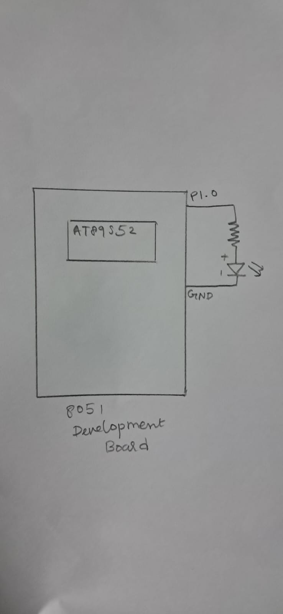

# CAT2 – Bare-Metal LED Blinking using AT89S52

## EXP
CAT2

## DATE
20/07/2026

## NAME OF EXP
8051 Tool Chain Setup and Bare-Metal LED Blinking using AT89S52

## HARDWARE SETUP / PLATFORM
- **Development Board:** 8051 Development Board
- **Microcontroller:** AT89S52
- **CPU Core:** 8051-compatible 8-bit microcontroller core
- **GPIO Port:** Port 1
- **GPIO Pin:** P1.0
- **Peripheral:** LED, Resistor
- **Programming Environment:** Keil µVision
- **Programming Language:** Embedded C
- **External Circuit Connection:** P1.0 → Resistor → LED → GND

## TASK NO
1. Hardware Board Bring-Up
2. Bare-Metal LED Blink
3. Development of a Custom Delay Function

## Circuit Diagram



The circuit consists of an AT89S52 microcontroller connected to an LED through Port 1, Pin 0 (P1.0). The LED is controlled by directly accessing the GPIO port using the 8051 SFR interface.

## Core Logic / Pseudocode / Code Base

The experiment demonstrates bare-metal programming of the AT89S52 microcontroller without using Arduino APIs, HAL libraries or RTOS services.

The LED is connected to P1.0, which is accessed using the `sbit` declaration.

A custom software delay function is implemented using a `for` loop with an unsigned character variable.

**Working:**

1. Declare P1.0 as `ledpin` using the `sbit` keyword.
2. Implement a delay function using a software loop.
3. Set the LED pin HIGH.
4. Call the delay function twice.
5. Set the LED pin LOW.
6. Call the delay function twice again.
7. Repeat the process continuously.

**Pseudocode:**

```text
START

Configure P1.0 as LED control pin

WHILE (1)
    Set LED pin HIGH
    Execute software delay twice

    Set LED pin LOW
    Execute software delay twice
END WHILE
```

**Source Code:** `EX 02.c`

The complete implementation is available in the source file included in this folder.

## INFERENCE

The AT89S52 microcontroller was programmed using Embedded C to control an LED through direct access to the GPIO port.

A custom software delay function was implemented using a loop, and the LED was continuously switched between HIGH and LOW states.

The experiment demonstrates basic bare-metal GPIO control and software-based delay generation without relying on high-level hardware abstraction libraries.

The delay was implemented using an uncalibrated software loop; an exact 1 Hz blinking frequency was not verified.