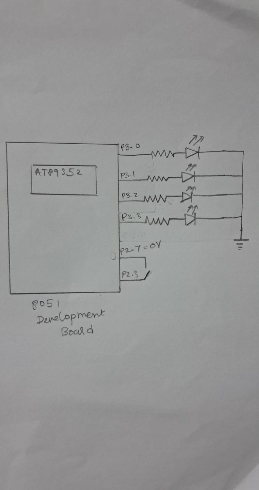

# CAT3 – Timer-Based LED Pattern Generator and Button Interrupt Controller

## EXP

CAT3

## DATE

27/07/2026

## NAME OF EXP

Timer-Based LED Pattern Generator and Button Interrupt Controller

## HARDWARE SETUP / PLATFORM

- **Development Board:** 8051 Development Board
- **Microcontroller:** AT89S52
- **CPU Core:** 8051-compatible 8-bit microcontroller core
- **Programming Environment:** Keil µVision
- **Programming Language:** Embedded C
- **LED Connections:**
  - LED1 – P3.0
  - LED2 – P3.1
  - LED3 – P3.2
  - LED4 – P3.3
- **Push Button Connections:**
  - P2.7 – Used to drive the button/keypad line LOW
  - P2.3 – Used to detect the button press (active LOW)
- **External Components:** Four LEDs, current-limiting resistors and a push button

## TASK NO

**Task: Timer-Based LED Pattern Generator and Button Interrupt Controller**

1. Configure four LEDs as digital outputs using direct GPIO register access.
2. Configure a push button as a digital input.
3. Implement four LED operating modes:
   - Mode 1 – Running LED Pattern
   - Mode 2 – 4-bit Binary Counter
   - Mode 3 – Alternating LED Pattern
   - Mode 4 – All LED Flash
4. Detect button presses and advance to the next operating mode.
5. Implement switch debouncing so that one physical press produces one state transition.

## Circuit Diagram



## Core Logic / Pseudocode / Code Base

The program implements a keypad-controlled human-machine interface using the AT89S52 microcontroller. The matrix keypad is used as the input device, the seven-segment display provides visual feedback, and four LEDs indicate the selected operating function.

### Pseudocode

```text
START

INITIALIZE:
    Set all four LEDs to OFF
    Clear the seven-segment display
    Set key = 10 (no key pressed)

REPEAT FOREVER:

    SCAN KEYPAD:
        Activate keypad rows one at a time
        Check the column inputs
        Identify the pressed key
        Store the key value

    DISPLAY:
        Convert the pressed key into its
        corresponding seven-segment pattern
        Display the digit

    SELECT OPERATION USING KEY:

        IF key is 1:
            Turn ON LED1
            Turn OFF other LEDs

        ELSE IF key is 2:
            Turn ON LED2
            Turn OFF other LEDs

        ELSE IF key is 3:
            Turn ON LED3
            Turn OFF other LEDs

        ELSE IF key is 4:
            Turn ON LED4
            Turn OFF other LEDs

        ELSE IF key is 5:
            Perform running LED pattern
            Scan keypad during delays

        ELSE IF key is 6:
            Perform alternating LED pattern
            Scan keypad during delays

        ELSE IF key is 7:
            Display binary count from 0 to 15
            using the four LEDs
            Scan keypad during delays

        ELSE IF key is 8:
            Blink all four LEDs
            Scan keypad during delays

        ELSE IF key is 9:
            Turn OFF all four LEDs

        ELSE IF key is 0:
            Reset key state
            Turn OFF all four LEDs
            Display zero

END REPEAT
```

### Working Principle

1. Initialize the four LEDs and seven-segment display.
2. Continuously scan the matrix keypad by activating its rows one at a time and checking the column inputs.
3. Identify the pressed key and store its value in the global variable `key`.
4. Display the corresponding digit on the seven-segment display using predefined hexadecimal patterns.
5. Use a `switch` statement to select the LED operation associated with the pressed key.
6. Execute the selected LED function.
7. Continue scanning the keypad during software delays to detect changes in the selected key.

### Key Operations

- **Keys 1–4 – Individual LED Control:** Turn ON the corresponding LED while turning OFF the remaining LEDs.
- **Key 5 – Running LED Pattern:** Turn ON LEDs sequentially from LED1 to LED4.
- **Key 6 – Alternating LED Pattern:** Alternate between LED2 and LED4 being ON together and LED1 and LED3 being ON together.
- **Key 7 – Binary Counter:** Display binary values from `0000` to `1111` using the four LEDs.
- **Key 8 – All LED Blink:** Turn all four LEDs ON and OFF repeatedly.
- **Key 9 – LED OFF:** Turn OFF all four LEDs.
- **Key 0 – Reset System:** Reset the key state, turn OFF all LEDs and display zero on the seven-segment display.

### Code Base

The implementation uses the `reg51.h` header file for direct access to the 8051 port pins. Separate functions are used for keypad scanning, seven-segment digit display, individual LED control, running LED pattern, alternating LED pattern, binary counting and blinking all LEDs.

A software delay function is used to control the timing of LED patterns while periodically scanning the keypad for changes in the selected key.

## INFERENCE

The experiment demonstrates register-level GPIO control using the AT89S52 microcontroller. Four LEDs are controlled through Port 3, while a push button connected to Port 2 is used to change the operating mode.

The program demonstrates four different LED patterns: sequential LED running, binary counting, alternating LEDs and simultaneous LED flashing. A software delay function is used to control the timing of the LED patterns.

The implementation demonstrates direct hardware control without using Arduino APIs, HAL libraries or RTOS services. The current implementation uses button polling and software delays rather than hardware timer interrupts or an external button interrupt.
