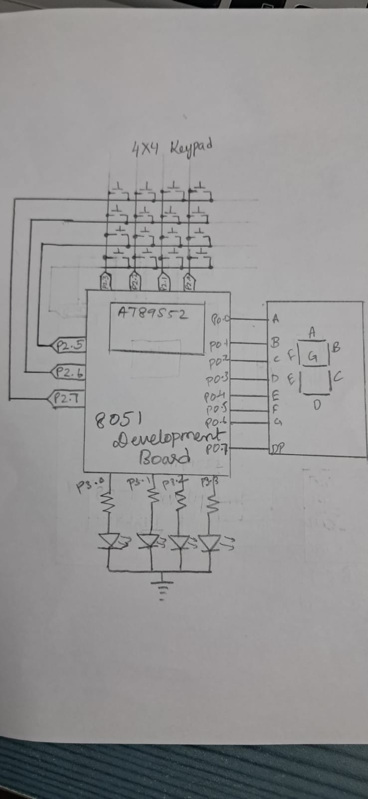

# CAT4 – Human-Machine Interface using Matrix Keypad, LEDs, and Seven-Segment Display

## EXP

CAT4

## DATE

03/08/2026

## NAME OF EXP

Human-Machine Interface using Matrix Keypad, LEDs, and Seven-Segment Display

## HARDWARE SETUP / PLATFORM

- **Development Board:** 8051 Development Board
- **Microcontroller:** AT89S52
- **CPU Core:** 8051-compatible 8-bit microcontroller core
- **Programming Environment:** Keil µVision
- **Programming Language:** Embedded C
- **Matrix Keypad Connections:**
  - Row 1 – P2.7
  - Row 2 – P2.6
  - Row 3 – P2.5
  - Column 1 – P2.3
  - Column 2 – P2.2
  - Column 3 – P2.1
  - Column 4 – P2.0
- **Seven-Segment Display:**
  - Segment outputs – P0.0 to P0.6
  - Decimal point – P0.7
- **LED Connections:**
  - LED1 – P3.0
  - LED2 – P3.1
  - LED3 – P3.2
  - LED4 – P3.3

## TASK NO

**Task: Human-Machine Interface using Matrix Keypad, LEDs, and Seven-Segment Display**

1. Configure and scan a matrix keypad to identify the pressed key.
2. Display the corresponding key value on the seven-segment display.
3. Control four LEDs according to the pressed key.
4. Implement a running LED pattern using key 5.
5. Implement an alternating LED pattern using key 6.
6. Implement a 4-bit binary counter from 0 to 15 using key 7.
7. Implement an all-LED blinking pattern using key 8.
8. Turn OFF all LEDs using key 9.
9. Reset the system using key 0.

## Circuit Diagram



## Core Logic / Pseudocode / Code Base

The program implements a keypad-controlled human-machine interface using the AT89S52 microcontroller. The matrix keypad is used as the input device, the seven-segment display provides visual feedback, and four LEDs indicate the selected operating function.

### Pseudocode

```text
START

INITIALIZE:
    Set all four LEDs to OFF
    Clear the seven-segment display
    Set key = 10 (no key pressed)

REPEAT FOREVER:

    SCAN KEYPAD:
        Activate keypad rows one at a time
        Check the column inputs
        Identify the pressed key
        Store the key value

    DISPLAY:
        Convert the pressed key into its
        corresponding seven-segment pattern
        Display the digit

    SELECT OPERATION USING KEY:

        IF key is 1:
            Turn ON LED1
            Turn OFF other LEDs

        ELSE IF key is 2:
            Turn ON LED2
            Turn OFF other LEDs

        ELSE IF key is 3:
            Turn ON LED3
            Turn OFF other LEDs

        ELSE IF key is 4:
            Turn ON LED4
            Turn OFF other LEDs

        ELSE IF key is 5:
            Perform running LED pattern
            Scan keypad during delays

        ELSE IF key is 6:
            Perform alternating LED pattern
            Scan keypad during delays

        ELSE IF key is 7:
            Display binary count from 0 to 15
            using the four LEDs
            Scan keypad during delays

        ELSE IF key is 8:
            Blink all four LEDs
            Scan keypad during delays

        ELSE IF key is 9:
            Turn OFF all four LEDs

        ELSE IF key is 0:
            Reset key state
            Turn OFF all four LEDs
            Display zero

END REPEAT
```

### Working Principle

1. Initialize the four LEDs and seven-segment display.
2. Continuously scan the matrix keypad by activating its rows one at a time and checking the column inputs.
3. Identify the pressed key and store its value in the global variable `key`.
4. Display the corresponding digit on the seven-segment display using predefined hexadecimal patterns.
5. Use a `switch` statement to select the LED operation associated with the pressed key.
6. Execute the selected LED function.
7. Continue scanning the keypad during software delays to detect changes in the selected key.

### Key Operations

- **Keys 1–4 – Individual LED Control:** Turn ON the corresponding LED while turning OFF the remaining LEDs.
- **Key 5 – Running LED Pattern:** Turn ON LEDs sequentially from LED1 to LED4.
- **Key 6 – Alternating LED Pattern:** Alternate between LED2 and LED4 being ON together and LED1 and LED3 being ON together.
- **Key 7 – Binary Counter:** Display binary values from `0000` to `1111` using the four LEDs.
- **Key 8 – All LED Blink:** Turn all four LEDs ON and OFF repeatedly.
- **Key 9 – LED OFF:** Turn OFF all four LEDs.
- **Key 0 – Reset System:** Reset the key state, turn OFF all LEDs and display zero on the seven-segment display.

### Code Base

The implementation uses the `reg51.h` header file for direct access to the 8051 port pins. Separate functions are used for keypad scanning, seven-segment digit display, individual LED control, running LED pattern, alternating LED pattern, binary counting and blinking all LEDs.

A software delay function is used to control the timing of LED patterns while periodically scanning the keypad for changes in the selected key.

## INFERENCE

The experiment demonstrates the implementation of a basic human-machine interface using the AT89S52 microcontroller. A matrix keypad is used to provide user input, a seven-segment display shows the pressed key, and four LEDs provide visual feedback based on the selected operation.

The program demonstrates individual LED control, sequential LED running, alternating LED patterns, binary counting, simultaneous LED blinking and system reset functionality.

The implementation uses direct port-pin access and Embedded C without Arduino APIs, HAL libraries or RTOS services. Keypad scanning and LED operations are implemented using separate functions and software delays.
