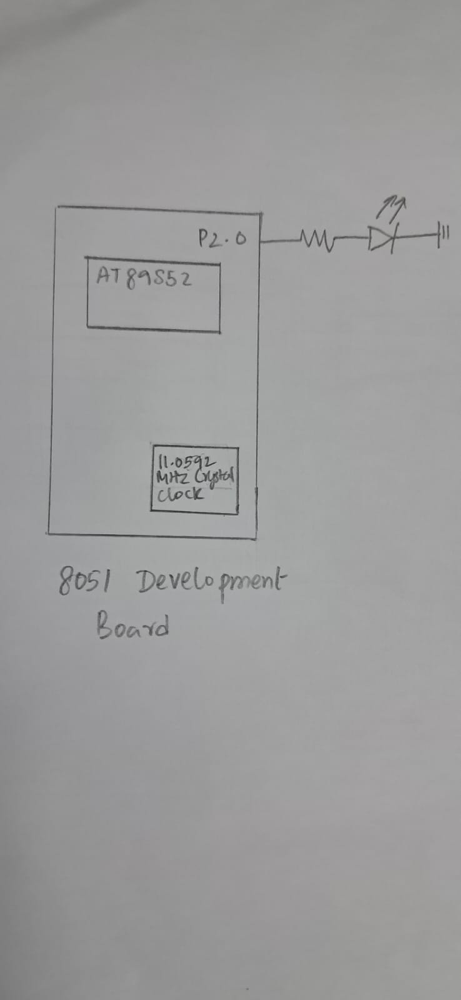

# CAT5 – Task 1: Timer 0 Configuration and LED Toggling

## EXP

CAT5

## DATE

10/08/2026

## NAME OF EXP

Hardware Timer and Interrupt-Based Timing for LED Fading, Pulse Generation, and Stepper Motor Control

## HARDWARE SETUP / PLATFORM

- **Development Board:** 8051 Development Board
- **Microcontroller:** AT89S52
- **CPU Core:** 8051-compatible 8-bit microcontroller core
- **Crystal Frequency:** 11.0592 MHz
- **Timer Used:** Timer 0
- **Timer Mode:** Mode 1 (16-bit timer mode)
- **LED Connection:** P2.0
- **Programming Environment:** Keil µVision (Keil C51)
- **Programming Language:** Embedded C
- **Timing Mechanism:** Hardware timer with overflow flag polling
- **Implementation Constraint:** No Arduino APIs, HAL libraries or RTOS services.

## TASK NO

**Task 1 – Timer 0 Configuration and LED Toggling**

1. Configure Timer 0 in Mode 1 (16-bit timer mode).
2. Use an 11.0592 MHz crystal frequency.
3. Load Timer 0 with the preload value `FC66H` to obtain an approximately 1 ms overflow interval.
4. Start Timer 0 and continuously monitor the overflow flag (`TF0`).
5. Clear the overflow flag and reload the timer after each overflow.
6. Count the timer overflows using a software counter.
7. Toggle the LED connected to P2.0 after the required number of overflows to generate an approximately 1-second interval between LED state changes.

## Circuit Diagram



## Core Logic / Pseudocode / Code Base

### Working Principle

Timer 0 is configured in 16-bit Mode 1. With an 11.0592 MHz crystal, the classic 12-clock 8051 requires approximately 1.085 microseconds per machine cycle.

The timer is loaded with `FC66H`, which requires 922 timer increments to overflow, producing an interval of approximately 1 ms.

The program continuously checks the `TF0` flag. Whenever an overflow occurs, the software counter is incremented. After 1000 overflows, the LED connected to P2.0 is toggled.

### Pseudocode

```text
START

    Initialize overflow counter to 0

    Configure Timer 0 in Mode 1
    Load TH0 = FC
    Load TL0 = 66

    Start Timer 0

    REPEAT FOREVER:

        Check TF0 flag

        IF TF0 = 1:

            IF counter = 999:
                Toggle LED connected to P2.0
                Reset counter to 0

            ELSE:
                Increment counter

            Clear TF0 flag

            Reload TH0 = FC
            Reload TL0 = 66

END
```

### Code Base

The program is implemented in Embedded C using the `reg51.h` header file to access the AT89S52 registers and GPIO pins.

Timer 0 is configured using the `TMOD` register, while `TH0` and `TL0` are loaded with the initial timer value. The `TR0` bit starts the timer, and the `TF0` flag is monitored through polling to detect timer overflow.

A software counter tracks the number of overflows. Once the required count is reached, the LED state is toggled.

The implementation uses timer overflow flag polling and does not use a Timer 0 interrupt service routine.

## INFERENCE

The experiment demonstrates the configuration and operation of Timer 0 in 16-bit Mode 1 using the AT89S52 microcontroller.

The timer overflow flag is monitored through polling, and a software counter is used to generate a longer time interval from repeated timer overflows.

The LED connected to P2.0 toggles at approximately one-second intervals, demonstrating hardware timer configuration, overflow detection, software time-base generation and GPIO control using Embedded C.