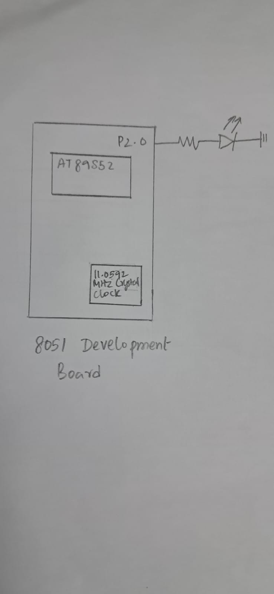

# CAT5 – Task 2: LED Fading Using Software PWM

## EXP
CAT5

## DATE
10/08/2026 (Week 4)

## NAME OF EXP
Hardware Timer and Interrupt-Based Timing for LED Fading, Pulse Generation, and Stepper Motor Control

## HARDWARE SETUP / PLATFORM
- **Microcontroller:** AT89S52 (8051 family)
- **Development Board:** 8051 Development Board
- **Clock Frequency:** 11.0592 MHz
- **Timer:** Timer 0, Mode 1 (16-bit)
- **Output Pin:** P2.0
- **Peripheral:** LED connected to P2.0
- **Software:** Keil µVision with Keil C51 compiler
- **Programming Language:** Embedded C

## TASK NO
**Task 2 – LED fading using software PWM**

The objective is to generate a software PWM signal using Timer 0 and gradually vary its duty cycle from 0% to 100% and back to 0%, producing a visible LED fading effect.

## Circuit Diagram



**Pin connection:** P2.0 is used as the LED control output. The LED connection and polarity should match the actual development board or external circuit used during the experiment.

## Core Logic / Pseudocode / Code Base

### Working Principle

Timer 0 is configured in Mode 1 (16-bit timer mode). The timer is loaded with `TH0 = 0xFF` and `TL0 = 0xA4`, producing an overflow interval of approximately 100 µs with an 11.0592 MHz crystal.

The program monitors the Timer 0 overflow flag (`TF0`). Whenever an overflow occurs, it clears the flag and reloads the timer.

Software PWM is generated by dividing each PWM cycle into 10 steps. The brightness level determines how many of these steps the LED remains ON.

### PWM Brightness Control

| Brightness Level | Duty Cycle | LED State |
|---|---:|---|
| 0 | 0% | OFF |
| 1 | 10% | Dim |
| 2 | 20% | Dim |
| 3 | 30% | Dim |
| 4 | 40% | Medium |
| 5 | 50% | Medium |
| 6 | 60% | Medium |
| 7 | 70% | Bright |
| 8 | 80% | Bright |
| 9 | 90% | Bright |
| 10 | 100% | Fully ON |

### Pseudocode

```text
START

1. Initialize Timer 0 in Mode 1 (16-bit timer mode).

2. Load Timer 0:
      TH0 = 0xFF
      TL0 = 0xA4

3. Start Timer 0.

4. Initialize:
      LED = OFF
      count = 0
      brightness_counter = 0
      level = 0
      dir = 1

5. REPEAT FOREVER:

      Check Timer 0 overflow flag (TF0).

      IF TF0 == 1:

          IF brightness_counter == 999:

              IF level == 10:
                  Set dir = -1

              IF level == 0:
                  Set dir = 1

              IF dir == 1:
                  Increment level

              ELSE:
                  Decrement level

              Reset brightness_counter = 0

          ELSE:
              Increment brightness_counter

          IF level == 0:
              Turn LED OFF

          ELSE IF level == 10:
              Turn LED ON

          ELSE:

              IF count < level:
                  Turn LED ON

              ELSE:
                  Turn LED OFF

              IF count == 9:
                  Reset count = 0

              ELSE:
                  Increment count

          Clear TF0.

          Reload Timer 0:
              TH0 = 0xFF
              TL0 = 0xA4

END
```

### Code Base

The implementation uses the following variables:

- `count` – Tracks the current PWM step (0–9).
- `brightness_counter` – Controls how frequently the brightness level changes.
- `level` – Represents the brightness level from 0 to 10.
- `dir` – Determines whether brightness is increasing or decreasing.
- `led` – Represents the LED connected to P2.0.

The program uses Timer 0 overflow polling to maintain the PWM timing. The PWM counter controls the ON/OFF duration of the LED, while the brightness counter gradually changes the duty cycle.

The timer reload value provides an overflow interval of approximately 100 µs. With 10 PWM steps per cycle, the resulting PWM frequency is approximately 1 kHz.

## INFERENCE

Successfully implemented software PWM-based LED brightness control using Timer 0 of the AT89S52 microcontroller. The duty cycle is gradually increased from 0% to 100% and then decreased back to 0%, producing a visible LED fading effect.

The experiment demonstrates how PWM duty-cycle variation can control the average power delivered to an LED and thereby control its perceived brightness. It also demonstrates the use of a hardware timer as a timing reference for software-based control.