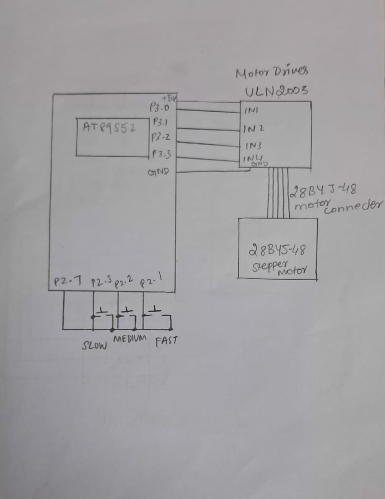

# CAT5 – Task 3: Stepper Motor Speed and Direction Control

## EXP
CAT5

## DATE
10/08/2026 (Week 4)

## NAME OF EXP
Hardware Timer and Interrupt-Based Timing for LED Fading, Pulse Generation, and Stepper Motor Control

## HARDWARE SETUP / PLATFORM
- **Microcontroller:** AT89S52 (8051 family)
- **Development Board:** 8051 Development Board
- **Clock Frequency:** 11.0592 MHz
- **Timer:** Timer 0, Mode 1 (16-bit timer)
- **Stepper Motor Control Pins:** P3.0, P3.1, P3.2 and P3.3
- **Speed Selection Inputs:** P2.3, P2.2 and P2.1
- **Keypad Control Pin:** P2.7
- **Motor Driver:** L298N Dual H-Bridge Motor Driver
- **Software:** Keil µVision with Keil C51 compiler
- **Programming Language:** Embedded C

## TASK NO
**Task 3 – Stepper Motor Speed and Direction Control (Optional)**

The objective is to control the stepping sequence of a stepper motor using Timer 0 interrupts. Different motor speeds are selected using input buttons.

The timer interval determines the time between successive motor steps.

## Circuit Diagram

The circuit consists of the AT89S52 microcontroller, L298N motor driver, stepper motor and speed-selection buttons.

**Pin connections:**
- P3.0–P3.3: Stepper motor control signals connected to the L298N driver inputs.
- P2.3: Slow-speed selection.
- P2.2: Medium-speed selection.
- P2.1: Fast-speed selection.
- P2.7: Keypad row control.
- L298N: Drives the stepper motor using the control signals received from the microcontroller.

The L298N acts as the motor driver between the microcontroller and the stepper motor, providing the required motor-driving capability.

## Core Logic / Pseudocode / Code Base

### Working Principle

Timer 0 is configured in Mode 1 (16-bit timer mode) and generates periodic interrupts at approximately 1 ms intervals.

The Timer 0 interrupt service routine increments the variable `count` and reloads the timer with:

- `TH0 = 0xFC`
- `TL0 = 0x66`

The main program scans the speed-selection buttons and selects one of three operating modes. The selected mode determines how many timer interrupts must occur before the motor advances to its next step.

### Stepper Motor Sequence

The motor is controlled using a four-step excitation sequence:

| Step | P3.3 | P3.2 | P3.1 | P3.0 |
|---|---:|---:|---:|---:|
| 1 | 0 | 0 | 0 | 1 |
| 2 | 0 | 0 | 1 | 0 |
| 3 | 0 | 1 | 0 | 0 |
| 4 | 1 | 0 | 0 | 0 |

After the fourth step, the sequence repeats from the first step.

### Speed Selection

| Mode | Button | Timer Interrupts per Step | Approximate Step Interval |
|---|---|---:|---:|
| Slow | P2.3 | 100 | 100 ms |
| Medium | P2.2 | 50 | 50 ms |
| Fast | P2.1 | 10 | 10 ms |

The selected mode determines the number of Timer 0 interrupts required before the next motor step is generated.

### Pseudocode

**START**

1. Declare and initialize the variables:
   - `count = 0` to count timer interrupts.
   - `step = 0` to track the current motor step.
   - `key = 0` to store the selected speed mode.

2. Configure Timer 0 in Mode 1 (16-bit timer mode).

3. Load Timer 0 with `TH0 = 0xFC` and `TL0 = 0x66`.

4. Enable global interrupts (`EA = 1`) and Timer 0 interrupts (`ET0 = 1`).

5. Start Timer 0 (`TR0 = 1`).

6. **Timer 0 Interrupt Service Routine:**
   - Increment `count`.
   - Clear the Timer 0 overflow flag.
   - Reload Timer 0 with `0xFC66`.

7. **Repeat continuously in the main program:**
   - Scan the speed-selection buttons using `keypad_scan()`.
   - If a new button press is detected:
     - Store the selected mode in `key`.
     - Reset `count` to zero.
   - Update the previous button state.

8. **Check the selected speed mode:**

   **If `key == 1` (Slow mode):**
   - Check whether `count == 99`.
   - If true:
     - Generate the next motor step using `movement()`.
     - Reset `count` to zero.
     - Increment `step`.
     - If `step == 4`, reset `step` to zero.

   **If `key == 2` (Medium mode):**
   - Check whether `count == 49`.
   - If true:
     - Generate the next motor step using `movement()`.
     - Reset `count` to zero.
     - Increment `step`.
     - If `step == 4`, reset `step` to zero.

   **If `key == 3` (Fast mode):**
   - Check whether `count == 9`.
   - If true:
     - Generate the next motor step using `movement()`.
     - Increment `step`.
     - Reset `count` to zero.
     - If `step == 4`, reset `step` to zero.

9. Repeat the selected mode and motor stepping sequence continuously.

**END**

### Code Base

The implementation uses the following variables and functions:

- `count` – Counts Timer 0 interrupts.
- `step` – Tracks the current position in the four-step motor sequence.
- `key` – Stores the selected speed mode.
- `timer_0()` – Timer 0 interrupt service routine that increments the interrupt counter and reloads the timer.
- `movement()` – Generates the four-step excitation sequence using P3.0–P3.3.
- `mode_1()` – Implements slow-speed operation.
- `mode_2()` – Implements medium-speed operation.
- `mode_3()` – Implements fast-speed operation.
- `keypad_scan()` – Detects the selected speed button.

The AT89S52 sends the stepping signals to the L298N motor driver, which drives the stepper motor. The motor advances through the excitation sequence repeatedly, while the selected speed mode determines the interval between successive steps.

## INFERENCE

Successfully implemented timer-based stepper motor control using the AT89S52 microcontroller and L298N motor driver. Timer 0 interrupts provide the timing reference, while the main program selects the motor speed according to the button inputs.

Three speed modes are implemented: slow (100 ms/step), medium (50 ms/step) and fast (10 ms/step). The experiment demonstrates how timer interrupts can be used to generate periodic control signals and regulate the stepping speed of a motor.

The implemented sequence provides forward stepping. Reverse-direction control is not included in this code.