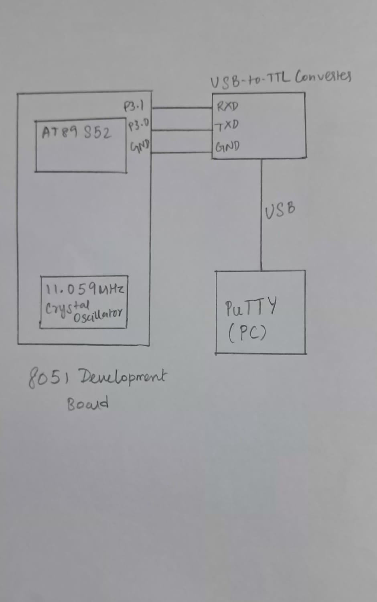

# CAT6 – Task 1: UART Initialization and Character Transmission

## EXP
CAT6

## DATE
17/08/2026 (Week 5)

## NAME OF EXP
UART Driver and Serial Debugging

## HARDWARE SETUP / PLATFORM

- **Development Board:** 8051 Development Board
- **Microcontroller:** AT89S52 (8051 family)
- **Crystal Frequency:** 11.0592 MHz
- **UART Mode:** Mode 1 (8-bit UART, asynchronous communication)
- **Baud Rate:** 9600 bps
- **Data Bits:** 8
- **Stop Bits:** 1
- **Parity:** None
- **Transmit Pin:** P3.1 (TXD)
- **Timer Used:** Timer 1
- **Timer Mode:** Mode 2 (8-bit auto-reload)
- **Serial Interface:** USB-to-TTL Converter
- **Terminal Software:** PuTTY
- **Programming Environment:** Keil µVision with Keil C51 compiler
- **Programming Language:** Embedded C

## TASK NO

**Task 1 – UART Initialization and Character Transmission**

The objective is to configure the AT89S52 UART for 9600-8-N-1 asynchronous serial communication and continuously transmit the message `Hello from 8051` to a PC terminal using a USB-to-TTL converter.

## Circuit Diagram



The circuit consists of the AT89S52 microcontroller, USB-to-TTL serial converter and PC terminal.

**Pin connections:**

- P3.1 (TXD) of AT89S52 → RXD of USB-to-TTL converter.
- GND of AT89S52 development board → GND of USB-to-TTL converter.
- USB-to-TTL converter → PC through USB.

The transmitted serial data is received by the PC terminal through the USB-to-TTL converter.

## Core Logic / Pseudocode / Code Base

### Working Principle

The UART is configured in Mode 1, which supports 8-bit asynchronous serial communication with a variable baud rate.

Timer 1 is configured in Mode 2 (8-bit auto-reload mode) to generate the baud-rate timing. With an 11.0592 MHz crystal and a reload value of `TH1 = 0xFD`, the UART operates at 9600 baud when the `SMOD` bit is cleared.

The `SBUF` register is used to load each character for transmission. Once a character has been transmitted, the `TI` (Transmit Interrupt) flag becomes 1. The program checks this flag through polling and clears it before transmitting the next character.

The message is stored in a character array. Its length is calculated using `sizeof(message) - 1`, excluding the null terminator. A loop transmits each character sequentially, and the process repeats continuously.

### UART Configuration

| Register / Bit | Configuration | Purpose |
|---|---|---|
| PCON | `0x00` | Clears SMOD for normal baud rate |
| SCON | `0x40` | Selects UART Mode 1 |
| TMOD | `0x20` | Configures Timer 1 in Mode 2 |
| TH1 | `0xFD` | Sets the reload value for 9600 baud |
| TL1 | `0xFD` | Initializes Timer 1 |
| TR1 | `1` | Starts Timer 1 |

### Pseudocode

```text
START

1. Declare a character array containing "Hello from 8051".

2. Configure UART:
   - Select UART Mode 1.
   - Clear the SMOD bit.

3. Configure Timer 1:
   - Select Mode 2 (8-bit auto-reload).
   - Load TH1 = 0xFD.
   - Load TL1 = 0xFD.
   - Start Timer 1.

4. Calculate the message length:
   - length = sizeof(message) - 1.

5. REPEAT FOREVER:

   FOR i = 0 TO length - 1:

      - Load message[i] into SBUF.
      - Wait until TI == 1.
      - Clear TI = 0.

   END FOR

6. Repeat the message transmission continuously.

END
```

### Code Base

The implementation uses the following registers and variables:

- `message[]` – Stores the string `Hello from 8051`.
- `length` – Stores the number of characters in the message, excluding the null terminator.
- `i` – Index used to access each character in the array.
- `PCON` – Controls the SMOD bit used for baud-rate selection.
- `SCON` – Configures the UART operating mode.
- `TMOD` – Configures Timer 1 in Mode 2.
- `TH1` and `TL1` – Store the Timer 1 reload and initial counter values.
- `TR1` – Starts Timer 1.
- `SBUF` – Holds the character to be transmitted.
- `TI` – Indicates completion of character transmission.

The program uses polling of the transmit flag (`TI`) to determine when each character has been transmitted. It does not use a UART interrupt service routine.

## INFERENCE

Successfully configured the AT89S52 UART for 9600-8-N-1 asynchronous serial communication using Timer 1 in Mode 2.

The message `Hello from 8051` is transmitted continuously to the PC terminal through the USB-to-TTL converter.

The experiment demonstrates UART initialization, baud-rate generation, serial data transmission using the `SBUF` register and transmission-completion detection using the `TI` flag.