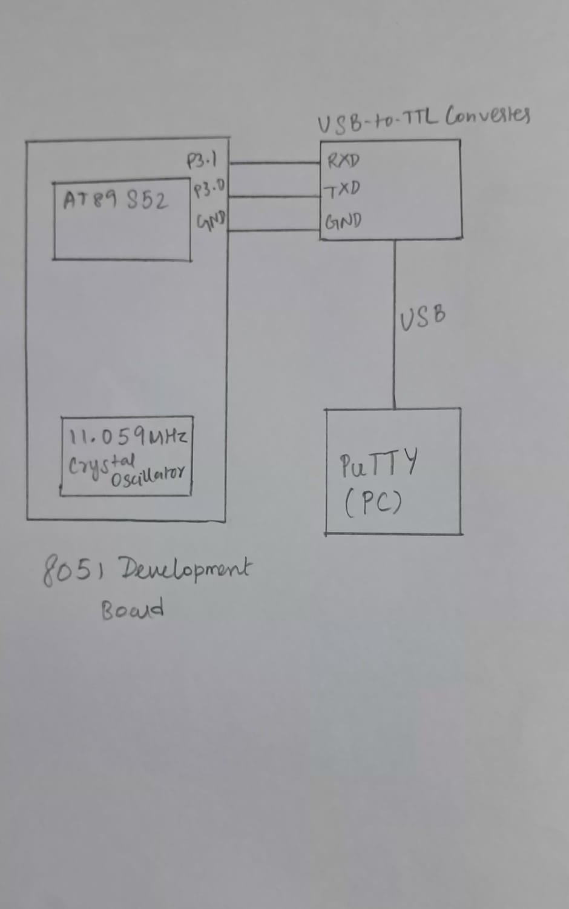

# CAT6 – Task 2: UART Echo using 8051 Serial Communication

## 1. EXP
CAT6 – Task 2

## 2. DATE
17/08/2026 (Week 5)

## 3. NAME OF EXP
UART Driver and Serial Debugging

## 4. HARDWARE SETUP / PLATFORM
- **Microcontroller:** AT89S52 (8051)
- **Crystal Frequency:** 11.0592 MHz
- **Serial Interface:** USB-to-TTL Converter
- **Terminal Software:** PuTTY
- **Communication Settings:** 9600 baud, 8 data bits, No parity, 1 stop bit (9600-8-N-1)
- **Timer Used:** Timer 1, Mode 2 (8-bit auto-reload)
- **UART Mode:** Mode 1 (8-bit asynchronous communication)

## 5. TASK NO
Task 2 – UART Echo (corresponding to Task B in the lab sheet).

**Objective:** Receive characters transmitted from the PC terminal through UART and transmit the same characters back to the PC.

## 6. CIRCUIT DIAGRAM



**Connections:**
- AT89S52 TXD (P3.1) → USB-to-TTL RXD
- AT89S52 RXD (P3.0) → USB-to-TTL TXD
- AT89S52 GND → USB-to-TTL GND
- USB-to-TTL converter → PC through USB

The AT89S52 board uses an 11.0592 MHz crystal for clock generation.

## 7. CORE LOGIC / PSEUDOCODE / CODE BASE

### Core Logic

The UART is configured in Mode 1 for 8-bit asynchronous serial communication. Timer 1 is configured in Mode 2 to generate the baud rate of 9600.

The program continuously checks the receive flag (RI). When a character is received, it reads the character from SBUF, clears RI, and places the same character into SBUF for transmission. It then waits for the transmit flag (TI) and clears it before receiving the next character.

### Pseudocode

```text
START

1. Initialize UART:
   - Set PCON = 0x00.
   - Configure SCON = 0x50 for UART Mode 1.
   - Configure Timer 1 in Mode 2.
   - Load TH1 and TL1 with 0xFD.
   - Start Timer 1.
   - Clear RI and TI.

2. REPEAT FOREVER:

   a. Wait until RI = 1.
   b. Read the received character from SBUF.
   c. Clear RI.
   d. Load the received character into SBUF.
   e. Wait until TI = 1.
   f. Clear TI.

END
```

### Expected Output

When the user types the following characters in PuTTY:

```text
ABC123
```

The 8051 receives each character and transmits it back to the PC terminal.

Expected terminal output:

```text
ABC123
```

## 8. INFERENCE

The experiment demonstrates bidirectional serial communication between the AT89S52 microcontroller and a PC terminal using UART.

UART Mode 1 was configured for 9600-8-N-1 communication, while Timer 1 in Mode 2 generated the required baud rate using the 11.0592 MHz crystal.

The RI and TI flags were used to identify the completion of character reception and transmission, respectively. The received character was read from SBUF and transmitted back to the PC, demonstrating UART echo functionality.

**Note:** This implementation uses polling to check RI and TI. It demonstrates basic UART reception and transmission but does not implement the interrupt-driven RX ring buffer mentioned in the overall lab problem statement.
