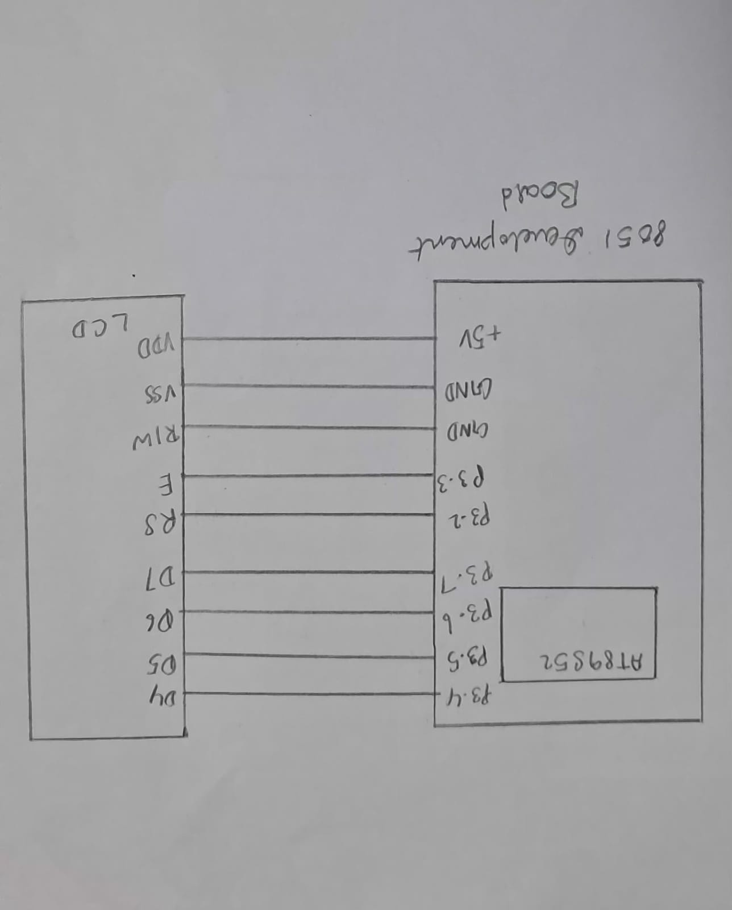
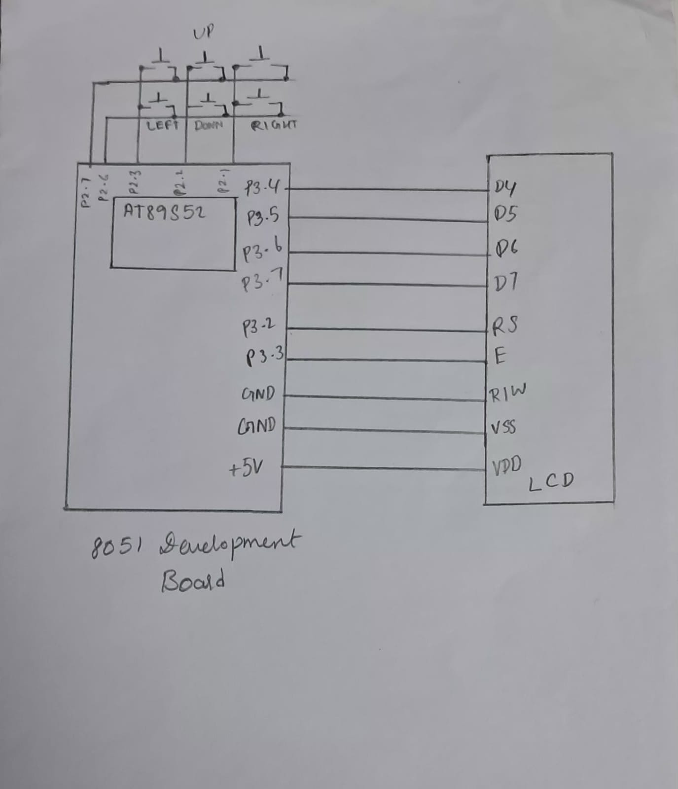

# CAT7 – 16×2 LCD Driver Development and Dynamic Display Control

## 1. EXP
CAT7

## 2. DATE
24/08/2026

## 3. NAME OF EXP
16×2 LCD Driver Development and Dynamic Display Control

## 4. HARDWARE SETUP / PLATFORM

- **Development Board:** 8051 Development Board
- **Microcontroller:** AT89S52
- **Display:** 16×2 HD44780-compatible Character LCD
- **Input Device:** 4×4 Matrix Keypad (Task 3)
- **LCD Interface:** 4-bit GPIO-based interface
- **LCD Data Pins:** P3.4–P3.7
- **LCD Enable Pin (E):** P3.3
- **LCD Register Select (RS):** P3.2
- **Keypad Pins:** P2.7, P2.6, P2.2, P2.3 and P2.1 (as declared in the supplied program)
- **Programming Language:** Embedded C
- **Development Environment:** Keil µVision

## 5. TASK NO

This experiment consists of three tasks:

### Task 1 – Task 7A: LCD Initialization and Character/String Display

Develop a 4-bit GPIO-based LCD driver and configure the 16×2 LCD for 4-bit, 2-line operation. Display character and string data.

[View Task 1 README](TASK1/README.md)

### Task 2 – Task 7B: Cursor Positioning and Dynamic Value Update

Develop cursor-positioning and data-update functions, including `lcd_goto()`, `lcd_puts()` and `lcd_print_number()`.

[View Task 2 README](TASK2/README.md)

### Task 3 – Task 7C: 4×4 Keypad-Based Character Movement

Develop an interactive application in which a character is moved across the 16×2 LCD using keypad directional inputs.

[View Task 3 README](TASK3/README.md)

## 6. CIRCUIT DIAGRAM

### Task 1 – LCD Initialization and Character/String Display



### Task 2 – Cursor Positioning and Dynamic Value Update


### Task 3 – 4×4 Keypad-Based Character Movement



**Common LCD Connections:**

| AT89S52 Pin | LCD Pin |
|---|---|
| P3.4 | D4 |
| P3.5 | D5 |
| P3.6 | D6 |
| P3.7 | D7 |
| P3.3 | E |
| P3.2 | RS |

The LCD also requires power, ground, contrast and RW connections. These must be represented according to the actual development board and laboratory wiring.

Task 3 additionally uses the keypad connections specified in its individual task documentation.

## 7. CORE LOGIC / PSEUDOCODE / CODE BASE

### Task 1 – LCD Initialization and Character/String Display

**Core Logic:**

- Configure the LCD interface using GPIO pins.
- Send initialization commands to configure the LCD.
- Configure display ON, cursor ON and cursor increment.
- Clear the display.
- Transmit character data using the LCD data pins.

**Important Concepts:**
- LCD command and data transmission.
- RS and Enable control signals.
- 4-bit communication.
- Software timing delays.

**Code Base:** `Task1/TASK1.c`

### Task 2 – Cursor Positioning and Dynamic Value Update

**Core Logic:**

- Initialize the LCD.
- Implement functions to send commands and character data.
- Calculate DDRAM addresses for cursor positioning.
- Display strings character by character.
- Convert integer values into individual decimal digits and display them in the correct order.
- Update the display by clearing and writing new content.

**Important Concepts:**
- DDRAM addressing.
- Cursor positioning.
- String handling.
- Integer-to-character conversion.
- Dynamic LCD updates.

**Code Base:** `Task2/TASK2.c`

### Task 3 – 4×4 Keypad-Based Character Movement

**Core Logic:**

- Initialize the LCD.
- Display the character `A` at the initial position (row 1, column 1).
- Scan keypad inputs continuously.
- Identify the selected direction.
- Erase the character from its current position.
- Update the row or column.
- Display the character at its new position.
- Prevent movement outside the LCD boundaries.

**Important Concepts:**
- Matrix keypad interfacing.
- GPIO input scanning.
- Software debouncing.
- LCD cursor positioning.
- Interactive display control.

**Code Base:** `Task3/TASK3.c`

### Overall Pseudocode

```text
START

1. Initialize the 8051 GPIO interface.

2. Initialize the 16×2 LCD in 4-bit mode.

3. Perform the selected task:

   TASK 1:
      Configure LCD display settings.
      Clear the display.
      Transmit character data.

   TASK 2:
      Implement LCD command and data functions.
      Position cursor using DDRAM addresses.
      Display strings and integer values.
      Update display contents.

   TASK 3:
      Initialize the keypad.
      Display character 'A' at the initial position.
      Continuously scan keypad inputs.
      Update character position according to direction.
      Maintain LCD row and column boundaries.

END
```

## 8. INFERENCE

The experiment demonstrates the interfacing and control of a 16×2 HD44780-compatible character LCD using the AT89S52 microcontroller.

It covers LCD initialization, 4-bit data communication, command and character transmission, DDRAM-based cursor positioning, string and integer display, and dynamic display updates.

The keypad-based movement task further demonstrates how GPIO inputs can be used to control the position of a character on an LCD.

Overall, the experiment provides practical experience in reading peripheral datasheets, deriving command sequences, developing low-level Embedded C drivers and interfacing external peripherals with an 8051 microcontroller.

**Implementation Note:** The supplied programs contain some initialization and keypad pin-mapping issues that should be verified against the actual hardware and LCD datasheet. The individual task READMEs document these observations. The code should not be considered a complete implementation of every required function until those issues are checked.
