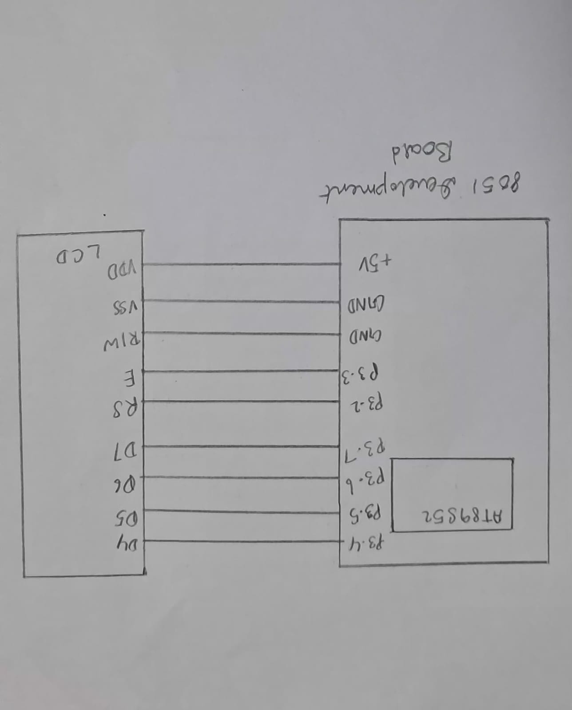

# CAT7 – Task 1: LCD Initialization and Character/String Display

## 1. EXP
CAT7

## 2. DATE
24/08/2026

## 3. NAME OF EXP
16×2 LCD Driver Development and Dynamic Display Control

## 4. HARDWARE SETUP / PLATFORM
- **Development Board:** 8051 Development Board
- **Microcontroller:** AT89S52
- **Display:** 16×2 HD44780-compatible Character LCD
- **Interface:** 4-bit GPIO-based LCD interface
- **Data Pins:** P3.4–P3.7
- **Enable Pin (E):** P3.3
- **Control Pin (RS):** P3.2
- **Programming Language:** Embedded C
- **Development Environment:** Keil µVision

The LCD uses four data lines (D4–D7) to communicate with the AT89S52. The RS pin selects between command and data operations, while the Enable pin controls the transfer of information.

## 5. TASK NO
Task 7A – LCD Initialization and Character/String Display

**Objective:** Develop a basic 4-bit GPIO-based LCD interface, configure the LCD for 4-bit and 2-line operation, and display character data.

## 6. CIRCUIT DIAGRAM



**Connections used by the program:**
- AT89S52 P3.4–P3.7 → LCD D4–D7
- AT89S52 P3.3 → LCD Enable (E)
- AT89S52 P3.2 → LCD Register Select (RS)

The LCD also requires power, ground and contrast connections. The RW pin and exact power/contrast wiring should be represented according to the actual laboratory circuit.

## 7. CORE LOGIC / PSEUDOCODE / CODE BASE

### Core Logic

The program attempts to initialize the 16×2 LCD using command nibbles and software delays.

The LCD is intended to be configured for:
- 4-bit communication.
- Display ON.
- Cursor ON with blinking.
- Automatic cursor increment after writing data.
- Display clearing before character transmission.

The program then repeatedly sends character data to the LCD through the GPIO pins.

### Pseudocode

```text
START

1. Configure the LCD interface pins.

2. Send Function Set command for 4-bit operation.

3. Configure display control:
   - Display ON.
   - Cursor ON.
   - Cursor blinking ON.

4. Configure Entry Mode:
   - Increment cursor after writing data.

5. Clear the LCD display.

6. REPEAT FOREVER:
   a. Send the upper nibble of the character.
   b. Send the lower nibble of the character.
   c. Apply the required delays.

END
```

### Code Base
`TASK1.c`

The program uses:
- `delay()` – Generates software delays and disables the LCD Enable signal.
- `P3` – Sends LCD data and control signals through the port.
- `E` – Controls the LCD Enable pin.

**Implementation observation:** The code comments indicate an intention to transmit the character `L` (ASCII `0x4C`). However, the lower-nibble output `0x3C` does not represent the lower nibble `0xC`. The Function Set sequence also has a lower-nibble mismatch. Therefore, the supplied code should be checked against the intended LCD command sequence before claiming successful character display.

## 8. INFERENCE

The experiment introduces the interfacing of a 16×2 character LCD with the AT89S52 microcontroller using a 4-bit GPIO-based interface.

It demonstrates the role of LCD control signals, command/data transfer, initialization commands and software timing delays.

The experiment provides an understanding of how a microcontroller communicates with an HD44780-compatible LCD using a reduced number of data pins.