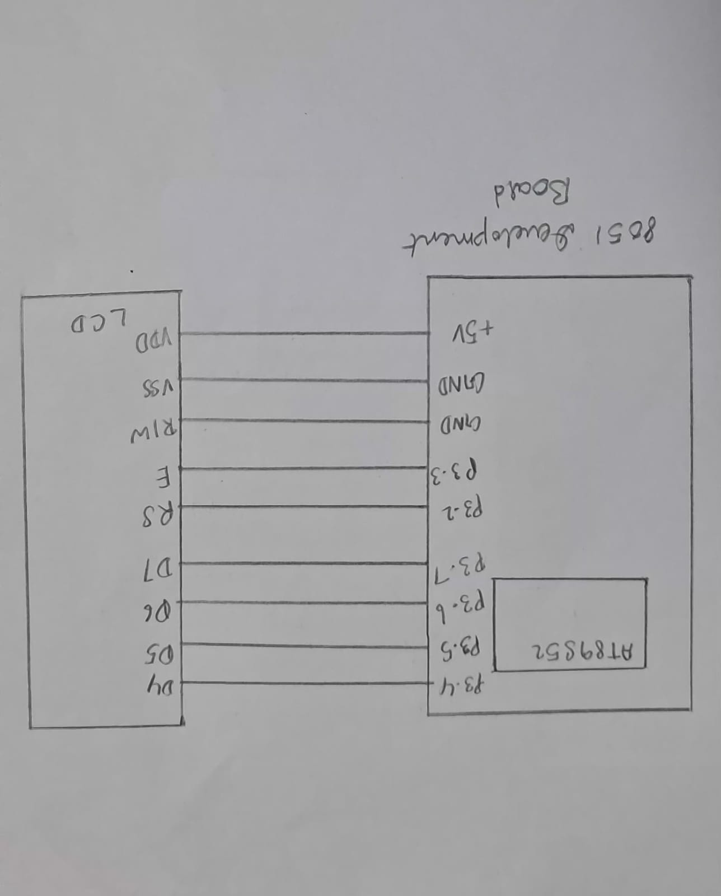

# CAT7 – Task 2: Cursor Positioning and Dynamic Value Update

## 1. EXP
CAT7

## 2. DATE
24/08/2026

## 3. NAME OF EXP
16×2 LCD Driver Development and Dynamic Display Control

## 4. HARDWARE SETUP / PLATFORM
- **Development Board:** 8051 Development Board
- **Microcontroller:** AT89S52
- **Display:** 16×2 HD44780-compatible Character LCD
- **Interface:** 4-bit GPIO-based LCD interface
- **Data Pins:** P3.4–P3.7
- **Enable Pin (E):** P3.3
- **Register Select (RS):** P3.2
- **Programming Language:** Embedded C
- **Development Environment:** Keil µVision

## 5. TASK NO
Task 7B – Cursor Positioning and Dynamic Value Update

**Objective:** Develop LCD driver functions to position the cursor, display strings and print integer values on a 16×2 LCD.

The following functions are implemented:
- `lcd_cmd()` – Sends commands to the LCD.
- `lcd_data()` – Sends character data to the LCD.
- `lcd_goto()` – Positions the LCD cursor at a specified row and column.
- `lcd_puts()` – Displays a string.
- `lcd_print_number()` – Displays an integer value.
- `lcd_init()` – Initializes the LCD in 4-bit mode.

## 6. CIRCUIT DIAGRAM



**Connections used by the program:**
- AT89S52 P3.4–P3.7 → LCD D4–D7
- AT89S52 P3.3 → LCD Enable (E)
- AT89S52 P3.2 → LCD Register Select (RS)

The LCD power, ground, contrast and RW connections must match the actual hardware setup.

## 7. CORE LOGIC / PSEUDOCODE / CODE BASE

### Core Logic

The program develops reusable LCD driver functions for sending commands, displaying character data, positioning the cursor and printing strings and numbers.

**1. LCD Command Transmission – `lcd_cmd()`**

The command byte is divided into two 4-bit nibbles. The upper nibble is transmitted first, followed by the lower nibble. RS is kept LOW to indicate command transmission.

**2. LCD Data Transmission – `lcd_data()`**

The character byte is divided into two nibbles and transmitted to the LCD. RS is set HIGH to indicate that the transmitted information represents character data.

**3. Cursor Positioning – `lcd_goto()`**

The LCD uses DDRAM addresses to identify character positions.

- First row begins at address `0x00`.
- Second row begins at address `0x40`.

The function calculates the required address and sends the Set DDRAM Address command.

**4. String Display – `lcd_puts()`**

The function reads characters from a string until the null terminator (`'\0'`) is encountered. It displays the characters one by one and moves to the second row when the position counter reaches 16.

**5. Number Display – `lcd_print_number()`**

The function extracts individual digits using division and modulus operations. Since the digits are extracted in reverse order, they are displayed from the last extracted digit to the first. It also handles negative numbers by displaying a minus sign.

**6. LCD Initialization – `lcd_init()`**

The function attempts to configure the LCD in 4-bit mode, enable the display and cursor, configure automatic cursor increment and clear the display.

### Pseudocode

```text
START

1. Initialize LCD:
   a. Send initialization nibbles.
   b. Configure 4-bit operation.
   c. Turn ON display and cursor.
   d. Enable cursor increment.
   e. Clear display.

2. Define LCD driver functions:

   lcd_cmd(command):
      Send upper nibble.
      Send lower nibble.
      Keep RS = 0.

   lcd_data(character):
      Send upper nibble.
      Send lower nibble.
      Set RS = 1.

   lcd_goto(row, column):
      Calculate DDRAM address.
      Send Set DDRAM Address command.

   lcd_puts(string):
      Read characters until '\0'.
      Display each character.
      Move to second row when required.

   lcd_print_number(value):
      Check whether value is negative.
      Extract digits using modulus and division.
      Display digits in correct order.

3. Initialize the LCD.

4. REPEAT FOREVER:
   a. Display "LCD testing..."
   b. Clear the display.
   c. Reset position counter.
   d. Display "Hello Dinesh Sir :)"
   e. Apply delay.
   f. Clear the display.
   g. Reset position counter.

END
```

### Code Base
`TASK2.c`

The main program displays two strings alternately:
- `LCD testing...`
- `Hello Dinesh Sir :)`

The display is cleared between the two messages.

**Implementation observation:** In the supplied `lcd_init()` function, `lcd_nibble(0x03, 30)` is called three times. However, `lcd_nibble()` applies `x & 0xF0`, which results in zero for the argument `0x03`. Therefore, those calls do not transmit the intended initialization nibble. The initialization sequence should be verified against the HD44780 datasheet.

## 8. INFERENCE

The experiment demonstrates the development of reusable LCD driver functions using Embedded C.

It introduces DDRAM addressing for cursor positioning, string handling, integer-to-character conversion and dynamic display updates.

The experiment provides an understanding of how low-level LCD commands can be organized into reusable functions to simplify interaction between the microcontroller and the display.