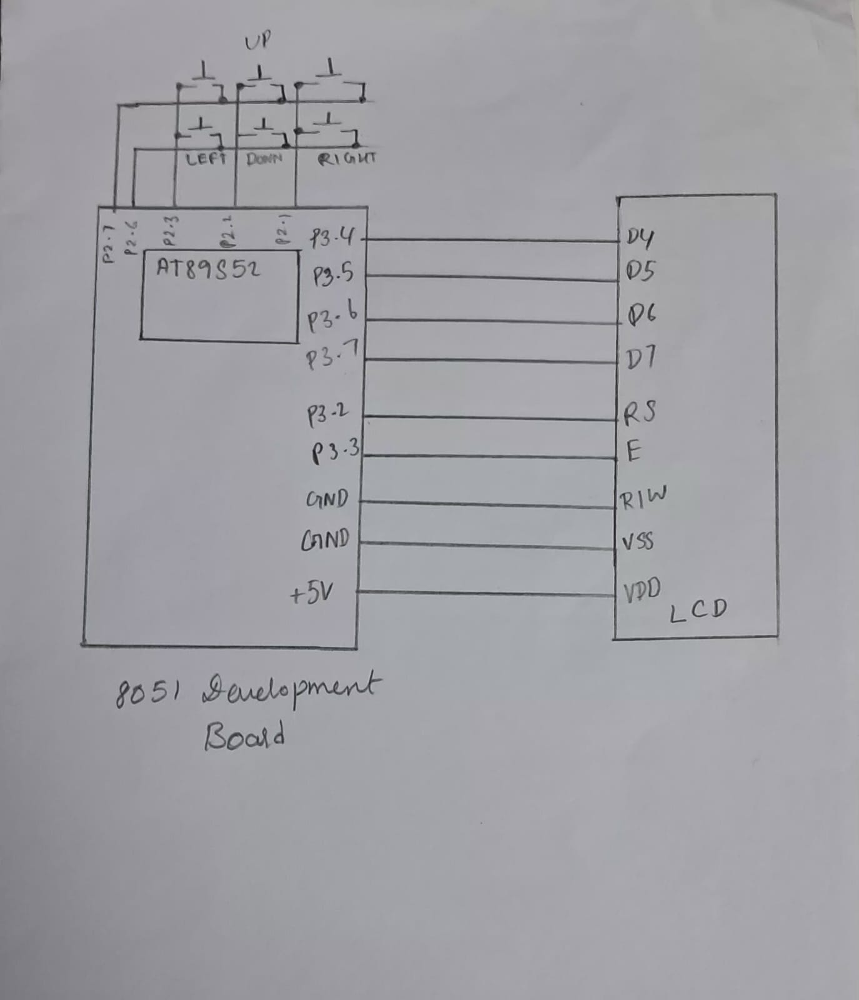

# CAT7 – Task 3: 4×4 Keypad-Based Character Movement

## 1. EXP
CAT7

## 2. DATE
24/08/2026

## 3. NAME OF EXP
16×2 LCD Driver Development and Dynamic Display Control

## 4. HARDWARE SETUP / PLATFORM
- **Development Board:** 8051 Development Board
- **Microcontroller:** AT89S52
- **Display:** 16×2 HD44780-compatible Character LCD
- **Input Device:** 4×4 Matrix Keypad
- **LCD Interface:** 4-bit GPIO-based interface
- **LCD Data Pins:** P3.4–P3.7
- **LCD Enable Pin (E):** P3.3
- **LCD Register Select (RS):** P3.2
- **Keypad Row Pins:** P2.7 and P2.6
- **Keypad Direction Signal Pins:** P2.2, P2.3 and P2.1
- **Programming Language:** Embedded C
- **Development Environment:** Keil µVision

## 5. TASK NO
Task 7C – 4×4 Keypad-Based Character Movement

**Objective:** Develop an interactive LCD application in which a character can be moved across the 16×2 LCD using keypad inputs.

The required directional controls from the lab sheet are:

| Key | Action |
|---|---|
| 2 | Move Up |
| 5 | Move Down |
| 4 | Move Left |
| 6 | Move Right |

The program uses the character `A` as the movable character.

## 6. CIRCUIT DIAGRAM



**LCD Connections:**
- AT89S52 P3.4–P3.7 → LCD D4–D7
- AT89S52 P3.3 → LCD Enable (E)
- AT89S52 P3.2 → LCD Register Select (RS)

**Keypad Connections indicated in the program:**
- P2.7 → ROW7
- P2.6 → ROW6
- P2.2 → UP and DOWN signals
- P2.3 → LEFT signal
- P2.1 → RIGHT signal

The LCD and keypad must share the appropriate ground connection with the development board. The exact keypad wiring should be represented according to the physical connections used in the laboratory.

## 7. CORE LOGIC / PSEUDOCODE / CODE BASE

### Core Logic

The program combines the LCD driver with keypad scanning to move a character across the display.

**1. LCD Initialization**

The LCD is configured for 4-bit communication, display ON, cursor ON and automatic cursor increment.

**2. Cursor Positioning – `lcd_goto()`**

The function calculates the DDRAM address corresponding to the required row and column and moves the LCD cursor to that position.

**3. Character Movement**

The current position is stored using two variables:
- `row` – Current LCD row (1 or 2).
- `col` – Current LCD column (1 to 16).

When a direction is selected:
1. The current character is erased by displaying a space.
2. The row or column value is updated.
3. The cursor is moved to the new position.
4. The character `A` is displayed at the new position.

Boundary conditions prevent the character from moving beyond the two rows and sixteen columns.

**4. Keypad Scanning – `keypad_scan()`**

The program scans the configured keypad signals and uses software delays for basic key debouncing. It returns a value corresponding to the detected direction.

**5. Main Program**

The character `A` is initially displayed at row 1, column 1. The program continuously scans the keypad and calls the corresponding movement function when a key is detected.

### Pseudocode

```text
START

1. Initialize LCD.

2. Set initial position:
   row = 1
   col = 1

3. Display character 'A' at row 1, column 1.

4. REPEAT FOREVER:

   a. Scan keypad.

   b. IF UP key is detected:
         IF row > 1:
            Erase character at current position.
            Decrement row.
            Display 'A' at new position.

   c. ELSE IF DOWN key is detected:
         IF row < 2:
            Erase character at current position.
            Increment row.
            Display 'A' at new position.

   d. ELSE IF LEFT key is detected:
         IF col > 1:
            Erase character at current position.
            Decrement col.
            Display 'A' at new position.

   e. ELSE IF RIGHT key is detected:
         IF col < 16:
            Erase character at current position.
            Increment col.
            Display 'A' at new position.

END
```

### Code Base
`TASK3.c`

The program contains the following functions:

- `lcd_cmd()` – Sends LCD commands.
- `lcd_data()` – Sends character data.
- `lcd_goto()` – Positions the cursor.
- `lcd_nibble()` – Sends a 4-bit initialization value.
- `lcd_init()` – Initializes the LCD.
- `move_up()` – Moves the character one position upward.
- `move_down()` – Moves the character one position downward.
- `move_left()` – Moves the character one position to the left.
- `move_right()` – Moves the character one position to the right.
- `keypad_scan()` – Scans the keypad and identifies the pressed direction.

**Implementation observations:**

1. The supplied code assigns both `UP` and `DOWN` to P2.2. These signals therefore share the same physical pin and cannot independently identify the two directions as written.
2. The keypad scanning function returns abstract values 1, 2, 3 and 4 for the four directions. The code does not explicitly identify the physical keypad key numbers 2, 8, 4 and 6 from the lab sheet.
3. The `lcd_nibble()` function masks its input using `x & 0xF0`. Consequently, the three calls with `0x03` in `lcd_init()` do not send the intended initialization nibble.

These details should be checked against the actual keypad wiring and the HD44780 initialization sequence.

## 8. INFERENCE

The experiment demonstrates the interfacing of a matrix keypad and a 16×2 LCD with the AT89S52 microcontroller.

It combines GPIO-based input scanning, software debouncing, LCD cursor positioning and character movement.

The program demonstrates how user input can be used to dynamically update the position of a character on an LCD while maintaining row and column boundary conditions.