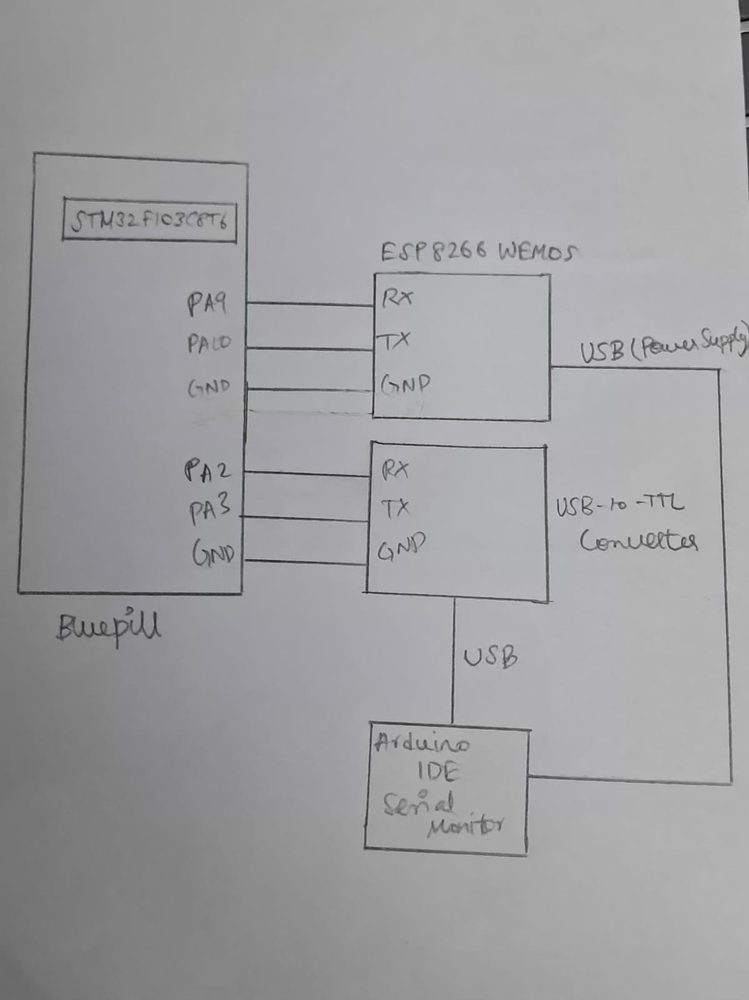

# EXP: CAT 10

**DATE:** 05/10/2026

**NAME OF EXP:** STM32-Wemos Wi-Fi Modem Interface Using AT Commands

**HARDWARE SETUP / PLATFORM:**
- STM32 Blue Pill Development Board (STM32F103C8T6)
- Wemos D1 Mini (ESP8266 Wi-Fi Module)
- Arduino IDE Serial Monitor
- USB-to-TTL converter for PC communication

**TASK NO:** Task1 – Establish STM32–Wemos UART Communication

## Circuit Diagram



## Core Logic / Pseudocode / Code Base

## Core Logic

The STM32 communicates with the Wemos ESP8266 module using USART1. It transmits the AT command followed by carriage return and line feed (`\r\n`) to request a response from the modem.

The ESP8266 processes the command and sends its response through UART. The STM32 receives the response one character at a time and forwards each character to the PC terminal through USART2. This allows the user to monitor the communication between STM32 and Wemos.

## Pseudocode

```text
START

Initialize HAL library
Configure system clock
Initialize GPIO
Initialize USART1
Initialize USART2

Store the AT command "AT\r\n"

Transmit the AT command through USART1

REPEAT
    Attempt to receive one character from Wemos through USART1
    IF a character is received successfully THEN
        Transmit the received character through USART2
    ELSE
        Stop receiving
    END IF
UNTIL response reception is complete

Wait for 500 milliseconds

Enter an infinite loop

END
```

## Code Base

- `HAL_Init()` initializes the STM32 HAL library.
- `SystemClock_Config()` configures the system clock.
- `MX_GPIO_Init()` initializes GPIO.
- `MX_USART1_UART_Init()` initializes UART communication with Wemos.
- `MX_USART2_UART_Init()` initializes UART communication with the PC terminal.
- `HAL_UART_Transmit()` transmits the AT command and forwards received characters.
- `HAL_UART_Receive()` receives the modem response one byte at a time.
- `HAL_Delay()` introduces a delay after communication.

## INFERENCE

Established UART communication between the STM32 and Wemos ESP8266 module using AT commands. The response from the Wi-Fi modem was received by STM32 and forwarded to the PC terminal for verification.