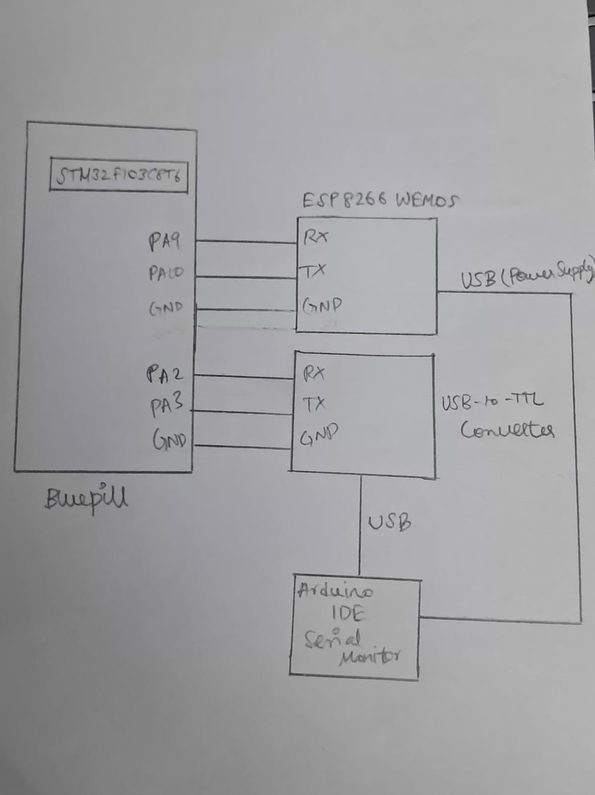

# EXP: CAT 10

**DATE:** 05/10/2026

**NAME OF EXP:** STM32-Wemos Wi-Fi Modem Interface Using AT Commands

**HARDWARE SETUP / PLATFORM:**
- STM32 Blue Pill Development Board (STM32F103C8T6)
- Wemos D1 Mini (ESP8266 Wi-Fi Module)
- Arduino IDE Serial Monitor
- USB-to-TTL converter for PC communication

**TASK NO:** Task2 – Explore the ESP8266 AT Command Interface

## Circuit Diagram



## Core Logic / Pseudocode / Code Base

## Core Logic

The STM32 communicates with the ESP8266 using a sequence of AT commands to configure its Wi-Fi functionality.

First, the `AT` command checks modem communication. The ESP8266 is then configured in station mode using `AT+CWMODE=1`. DHCP is enabled using `AT+CWDHCP=1,1`, allowing the module to obtain network configuration automatically.

Next, the `AT+CWJAP` command is used to connect the ESP8266 to the specified Wi-Fi access point using its SSID and password. Finally, `AT+CIFSR` requests the IP address information.

After each command, the STM32 receives the modem response through USART1 and forwards it to the PC terminal through USART2.

## Pseudocode

```text
START

Initialize HAL library
Configure system clock
Initialize GPIO
Initialize USART1
Initialize USART2

Define the following AT commands:
    AT
    AT+CWMODE=1
    AT+CWDHCP=1,1
    AT+CWJAP with Wi-Fi SSID and password
    AT+CIFSR

FOR each AT command in the sequence DO

    Transmit the command to Wemos through USART1

    Set reception timeout:
        5000 milliseconds for Wi-Fi connection command
        100 milliseconds for other commands

    REPEAT
        Attempt to receive one character through USART1

        IF reception is successful THEN
            Forward the character to PC through USART2
        ELSE
            Stop receiving for this command
        END IF

    UNTIL reception times out

    Wait for 500 milliseconds

END FOR

Enter an infinite loop

END
```

## Code Base

- `HAL_UART_Transmit()` sends the AT commands to the ESP8266.
- `HAL_UART_Receive()` receives modem responses one character at a time.
- `strlen()` calculates the length of each AT command string before transmission.
- `HAL_Delay()` introduces a delay between successive commands.
- `strcmp()` is not used in this implementation.
- USART1 handles STM32–Wemos communication, while USART2 forwards responses to the PC terminal.

**AT commands used:**

| Command | Purpose |
|---|---|
| `AT` | Check modem response |
| `AT+CWMODE=1` | Configure station mode |
| `AT+CWDHCP=1,1` | Enable DHCP for station mode |
| `AT+CWJAP` | Connect to Wi-Fi access point |
| `AT+CIFSR` | Obtain IP address information |

## INFERENCE

Explored the ESP8266 AT command interface and configured the Wi-Fi module to operate in station mode. Enabled DHCP, connected the module to the specified Wi-Fi access point and queried its IP address information. The modem responses were displayed on the PC terminal.