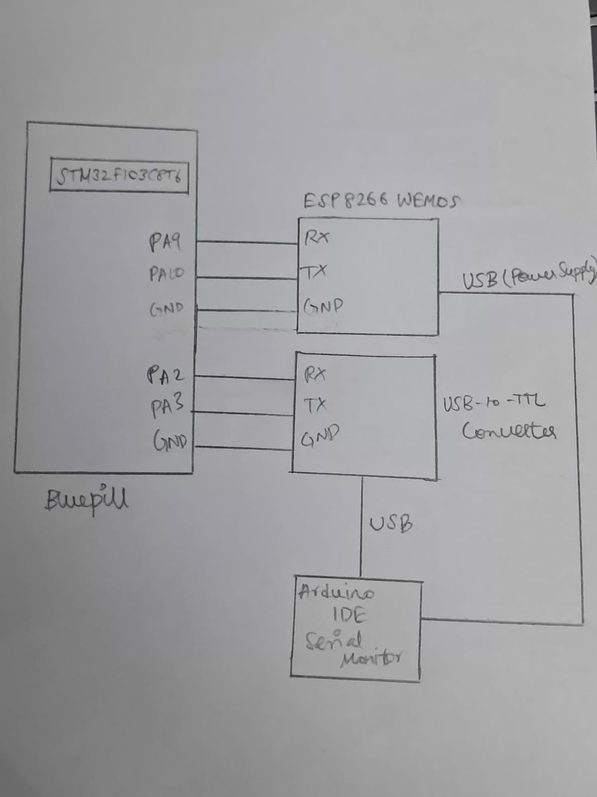

# EXP: CAT3

**DATE:** 05/10/2026

**NAME OF EXP:** STM32-Wemos Wi-Fi Modem Interface Using AT Commands

**HARDWARE SETUP / PLATFORM:**
- STM32 Blue Pill Development Board (STM32F103C8T6)
- Wemos D1 Mini (ESP8266 Wi-Fi Module)
- Arduino IDE Serial Monitor
- USB-to-TTL converter for PC communication

**TASK NO:** Task3 – Connect Wemos to Wi-Fi

## Circuit Diagram



## Core Logic / Pseudocode / Code Base

## Core Logic

The STM32 configures the ESP8266 Wi-Fi module through USART1 by transmitting a sequence of AT commands.

Initially, modem communication is checked using `AT`. The ESP8266 is configured in station mode, DHCP is enabled, and the module is connected to the specified Wi-Fi access point.

After obtaining the IP address information using `AT+CIFSR`, the STM32 enables multiple connections using `AT+CIPMUX=1`. It then starts an HTTP server on port 80 using `AT+CIPSERVER=1,80`.

After transmitting each command, the STM32 receives the response from the ESP8266 and forwards it to the PC terminal through USART2. Delays are introduced between commands to allow the modem to process them.

## Pseudocode

```text
START

Initialize HAL library
Configure system clock
Initialize GPIO
Initialize USART1
Initialize USART2

Define AT commands:
    AT
    AT+CWMODE=1
    AT+CWDHCP=1,1
    AT+CWJAP with Wi-Fi SSID and password
    AT+CIFSR
    AT+CIPMUX=1
    AT+CIPSERVER=1,80

Transmit AT command to check modem communication
Receive response through USART1
Forward response to PC through USART2
Wait for 500 milliseconds

Transmit AT+CWMODE=1 to configure station mode
Receive and forward modem response
Wait for 500 milliseconds

Transmit AT+CWDHCP=1,1 to enable DHCP
Receive and forward modem response
Wait for 500 milliseconds

Transmit AT+CWJAP with Wi-Fi credentials
Receive and forward modem response
Use a longer reception timeout of 5000 milliseconds
Wait for 500 milliseconds

Transmit AT+CIFSR to obtain IP address information
Receive and forward modem response
Wait for 500 milliseconds

Transmit AT+CIPMUX=1 to enable multiple connections
Receive and forward modem response
Wait for 500 milliseconds

Transmit AT+CIPSERVER=1,80 to start HTTP server
Receive and forward modem response
Wait for 500 milliseconds

Enter an infinite loop

END
```

## Code Base

- `HAL_UART_Transmit()` transmits AT commands to the ESP8266 through USART1.
- `HAL_UART_Receive()` receives modem responses one character at a time.
- `strlen()` calculates the length of command strings.
- `HAL_Delay()` introduces delays between successive AT commands.
- USART1 is used for communication between STM32 and Wemos.
- USART2 is used to forward modem responses to the PC terminal.

**AT commands used:**

| Command | Purpose |
|---|---|
| `AT` | Check modem communication |
| `AT+CWMODE=1` | Configure station mode |
| `AT+CWDHCP=1,1` | Enable DHCP |
| `AT+CWJAP` | Connect to Wi-Fi access point |
| `AT+CIFSR` | Obtain IP address information |
| `AT+CIPMUX=1` | Enable multiple connections |
| `AT+CIPSERVER=1,80` | Start HTTP server on port 80 |

## INFERENCE

Configured the Wemos ESP8266 as a Wi-Fi station and connected it to the specified access point. Obtained the IP address information, enabled multiple connections and configured an HTTP server on port 80. The modem responses were forwarded to the PC terminal through STM32.