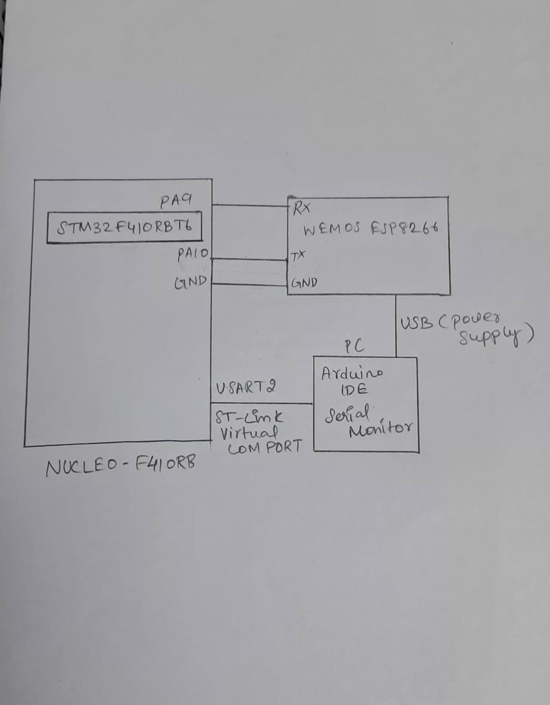

# EXP
CAT 11

# DATE
12/10/2026

# NAME OF EXP
HTTP Server - STM32–Wemos Wi-Fi Modem Using AT Commands

# HARDWARE SETUP / PLATFORM
- **Development Board:** NUCLEO-F410RB
- **Microcontroller:** STM32F410RBT6
- **Processor Core:** ARM Cortex-M4
- **Wi-Fi Module:** Wemos D1 (ESP8266)
- **Sensor:** Not used in this experiment; a static HTTP response is generated.
- **Communication:** UART using STM32 HAL libraries
- **PC Interface:** Arduino IDE Serial Monitor through USART2
- **Node-RED:** Used as an additional HTTP client to send requests and display the received response.
- **Software Tools:** STM32CubeMX, Keil MDK, Arduino IDE, Node-RED

**UART Configuration:**
- USART1: Communication between STM32 and ESP8266/Wemos.
- USART2: Forwarding ESP8266 responses and debugging messages to the PC.
- Baud rate: 115200
- Word length: 8 bits
- Stop bits: 1
- Parity: None
- Hardware flow control: None

# TASK NO
- **Task 10C:** Configure ESP8266 as a TCP Server.
- **Task 10D:** Observe and Process HTTP Requests and Construct a Static HTTP Response.
- **Task 10E:** Use Node-RED as a Second HTTP Client of the STM32/ESP8266 HTTP Server.

# CIRCUIT DIAGRAM

# CORE LOGIC

1. Initialize the STM32 HAL, system clock, GPIO, USART1 and USART2.
2. Initialize the ESP8266 communication through USART1.
3. Send `AT` to verify communication with the ESP8266.
4. Configure the ESP8266 as a Wi-Fi station using `AT+CWMODE=1`.
5. Enable DHCP for station mode using `AT+CWDHCP=1,1`.
6. Connect the ESP8266 to the configured Wi-Fi access point.
7. Retrieve the network IP information using `AT+CIFSR`.
8. Enable multiple TCP connections using `AT+CIPMUX=1`.
9. Start the TCP server on port 80 using `AT+CIPSERVER=1,80`.
10. Continuously receive data from the ESP8266 through USART1.
11. Forward the received data to the PC through USART2 for monitoring.
12. Search the received data for an `+IPD` frame indicating incoming network data.
13. Extract the TCP connection ID and received data length from the `+IPD` frame.
14. Check whether the received payload begins with an HTTP `GET` or `POST` request.
15. Construct a static HTML response containing the HTTP status line, headers, blank line and HTML body.
16. Calculate the complete HTTP response length.
17. Send `AT+CIPSEND` with the connection ID and response length.
18. Wait for the ESP8266 `>` prompt before transmitting the HTTP response.
19. Transmit the HTTP response through the ESP8266 to the requesting HTTP client.
20. Wait for the `SEND OK` acknowledgement or an error.
21. Close the TCP connection using `AT+CIPCLOSE`.
22. Use Node-RED's HTTP Request node to send an HTTP GET request to the ESP8266 server.
23. Display the HTTP response received from the STM32 through the Node-RED Debug node.

# PSEUDOCODE

**Step 1 – Initialize the STM32 and configure the ESP8266**

1. Start the HAL library.
2. Configure the system clock.
3. Initialize GPIO, USART1 and USART2.
4. Wait for the ESP8266 to become ready.
5. Send `AT` to check communication.
6. Send `AT+CWMODE=1` to configure station mode.
7. Send `AT+CWDHCP=1,1` to enable DHCP for station mode.
8. Send the Wi-Fi join command using the configured SSID and password.
9. Wait for `WIFI GOT IP` and `OK`, or stop waiting if an error occurs or the timeout expires.
10. Send `AT+CIFSR` to retrieve IP information.
11. Send `AT+CIPMUX=1` to enable multiple TCP connections.
12. Send `AT+CIPSERVER=1,80` to start the TCP server on port 80.

**Step 2 – Receive and process an HTTP request**

1. Continuously receive bytes from the ESP8266 through USART1.
2. Store the received bytes in a buffer.
3. Stop collecting when the reception timeout expires, no new byte arrives for 200 ms, or the buffer becomes full.
4. If data has been received:
   - Forward the collected data to the PC through USART2.
   - Add a null terminator to make the received data a string.
   - Search the buffer for the `+IPD,` marker.
5. If the marker is not found, return without processing the data.
6. Extract the TCP connection ID from the `+IPD` frame.
7. Extract the incoming payload length.
8. Check that the complete declared payload is present in the collected buffer.
9. Check whether the payload starts with `GET ` or `POST `.
10. If it is an HTTP request, call the HTTP response function using the extracted connection ID.

**Step 3 – Construct and transmit the HTTP response**

1. Define the HTML body containing:
   - A heading: `Hello from STM32!`
   - A paragraph: `ESP8266 communication successful.`
2. Calculate the HTML body length.
3. Construct the HTTP response containing:
   - Status line: `HTTP/1.1 200 OK`
   - Content-Type header: `text/html`
   - Content-Length header
   - Connection header: `close`
   - A blank line separating the headers and body
   - The HTML body
4. Calculate the complete HTTP response length.
5. Construct the command `AT+CIPSEND=<connection ID>,<response length>`.
6. Transmit the CIPSEND command to the ESP8266.
7. Wait up to 5 seconds for the `>` prompt.
8. If the prompt is not received, return without sending the HTTP response.
9. If the prompt is received, transmit the complete HTTP response.
10. Wait for the `SEND OK` acknowledgement or an error, for up to 3 seconds.
11. Send `AT+CIPCLOSE=<connection ID>` to close the TCP connection.

**Step 4 – Test using Node-RED**

1. Configure an Inject node to trigger an HTTP request.
2. Connect the Inject node to an HTTP Request node.
3. Configure the HTTP Request node with the ESP8266 server address: `http://<ESP8266_IP>/`.
4. Set the request method to GET.
5. Connect the HTTP Request node to a Debug node.
6. Deploy the Node-RED flow.
7. Trigger the Inject node to send an HTTP GET request to the ESP8266 server.
8. Observe the HTTP response returned by the STM32 in the Debug panel.

# CODE BASE

**Header files:**
- `main.h` – STM32 HAL definitions and peripheral declarations.
- `string.h` – String operations such as `strlen()`, `strstr()`, `strncmp()` and `memset()`.
- `stdio.h` – Formatted string construction using `snprintf()`.

**Important HAL functions:**
- `HAL_Init()` – Initializes the HAL library.
- `HAL_UART_Init()` – Initializes UART peripherals.
- `HAL_UART_Transmit()` – Transmits data through UART.
- `HAL_UART_Receive()` – Receives data through UART.
- `HAL_GetTick()` – Returns the HAL tick count for timeout measurement.
- `HAL_Delay()` – Provides a blocking delay.

**User-defined functions:**
- `ESP_SendCommand()` – Sends an AT command and forwards the collected response to the PC.
- `ESP_ConnectWiFi()` – Sends the Wi-Fi connection command and checks for successful connection indications.
- `receiveResponse()` – Collects incoming ESP8266 data, forwards it to the PC and passes it for processing.
- `ESP_ProcessReceivedData()` – Searches for and parses an `+IPD` frame and identifies HTTP GET or POST requests.
- `ESP_SendHTTPResponse()` – Constructs the HTTP response, sends it using `AT+CIPSEND`, checks the transmission acknowledgement and closes the TCP connection.

**Node-RED Flow:**
- Inject node – Triggers the HTTP request.
- HTTP Request node – Sends an HTTP GET request to the ESP8266 server.
- Debug node – Displays the HTTP response received from the STM32.

# INFERENCE

The STM32 successfully acts as the controller of an HTTP server using the ESP8266 Wi-Fi module. The ESP8266 handles the Wi-Fi and TCP communication, while the STM32 processes incoming HTTP request data and constructs the corresponding HTTP response.

The experiment demonstrates UART-based AT command communication, TCP server configuration, `+IPD` frame processing, HTTP response construction and transmission using `AT+CIPSEND`.

The HTTP server returns a static HTML response to requesting clients. The browser and Node-RED HTTP Request node can act as clients of the server. The received HTTP response can be observed through the browser and Node-RED Debug panel.

The experiment demonstrates communication between embedded hardware and an IoT application using Wi-Fi and HTTP.