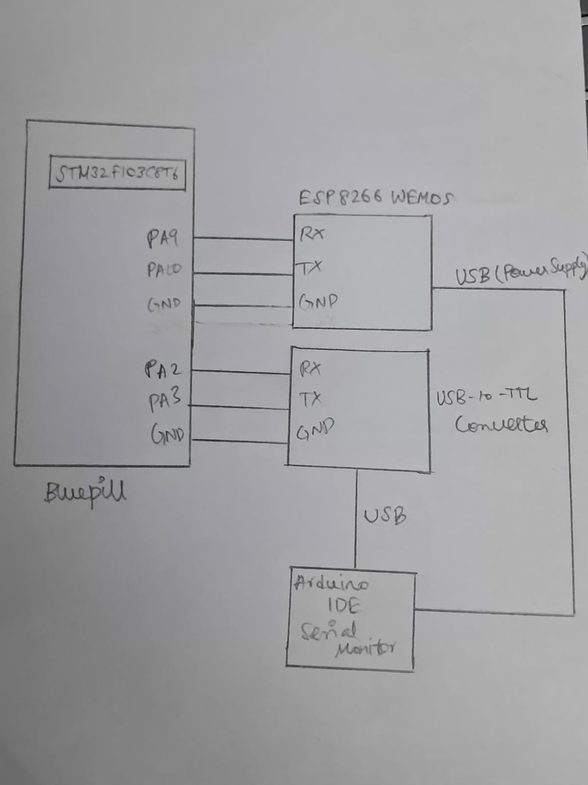

# EXP
CAT12 – Task1

# DATE
14/10/2026

# NAME OF EXP
STM32F401RE Cortex-M4: GPIO and User Input Programming

# HARDWARE SETUP / PLATFORM
- **Development Board:** NUCLEO-F401RE
- **Microcontroller:** STM32F401RET6
- **Processor Core:** ARM Cortex-M4
- **Peripheral Used:** On-board LED (LD2)
- **LED GPIO Pin:** PA5
- **Development Tools:** STM32CubeMX and Keil MDK
- **Software Library:** STM32 HAL

# TASK NO
Task 1 – On-board LED Bring-Up

# Circuit Diagram
The on-board LED (LD2) of the NUCLEO-F401RE board is connected internally to GPIO pin PA5.



No external LED or additional wiring is required. The NUCLEO-F401RE board is powered through its USB connection.

# CORE LOGIC / PSEUDOCODE / CODE BASE

## Core Logic
The program verifies the GPIO output configuration of the NUCLEO-F401RE board by blinking its on-board LED at a fixed interval.

- HAL is initialized.
- The system clock is configured.
- GPIO pin PA5 is configured as a general-purpose push-pull output.
- The LED is initially set to LOW.
- Inside the infinite loop, the output state of PA5 is toggled.
- A delay of 100 milliseconds is introduced between consecutive toggles.

## Pseudocode

```text
START

Initialize HAL
Configure system clock

Enable GPIOA clock
Configure PA5 as push-pull output
Set PA5 LOW

WHILE TRUE
    Toggle the output state of PA5
    Wait for 100 milliseconds
END WHILE

END
```

## Code Base
- `main.c` – Contains the main application logic, system clock configuration and GPIO initialization.
- `main.h` – Contains the project header declarations and HAL-related definitions.
- STM32CubeMX-generated project files – Contain the configuration and supporting files required to build the application.

# INFERENCE
The on-board LED connected to PA5 blinked continuously with a 100 ms interval between consecutive state changes. This verified the basic GPIO output configuration and LED control functionality of the NUCLEO-F401RE board.