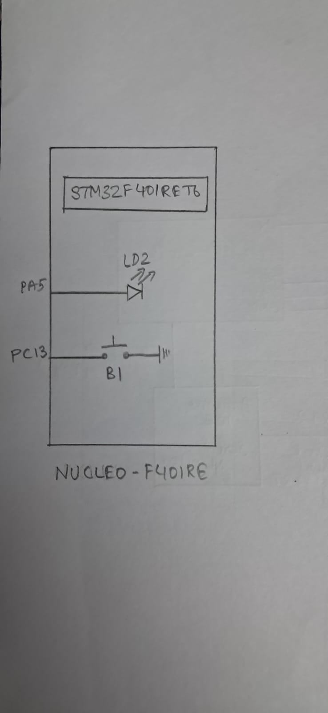

# EXP
CAT12 – Task2

# DATE
14/10/2026

# NAME OF EXP
STM32F401RE Cortex-M4: GPIO and User Input Programming

# HARDWARE SETUP / PLATFORM
- **Development Board:** NUCLEO-F401RE
- **Microcontroller:** STM32F401RET6
- **Processor Core:** ARM Cortex-M4
- **Input Peripheral:** On-board user push button (B1)
- **Button GPIO Pin:** PC13
- **Output Peripheral:** On-board LED (LD2)
- **LED GPIO Pin:** PA5
- **Development Tools:** STM32CubeMX and Keil MDK
- **Software Library:** STM32 HAL

# TASK NO
Task 2 – On-board Switch Control with State Remembrance

# Circuit Diagram
The on-board user push button (B1) is connected to GPIO pin PC13, while the on-board LED (LD2) is connected to GPIO pin PA5.



Both components are available on the NUCLEO-F401RE board. No external button, LED or additional wiring is required. The board is powered through USB.

# CORE LOGIC / PSEUDOCODE / CODE BASE

## Core Logic
The program reads the state of the on-board push button through GPIO pin PC13 and controls the LED connected to PA5.

- HAL and the system clock are initialized.
- GPIOC and GPIOA clocks are enabled.
- PC13 is configured as an input with an internal pull-up.
- PA5 is configured as a push-pull output.
- The program continuously reads the button state.
- When PC13 reads LOW, the LED is turned ON.
- When PC13 reads HIGH, the LED is turned OFF.

**Note:** The supplied implementation uses level-based control. Therefore, the LED remains ON only while the button is pressed and turns OFF after release. It does not toggle the LED state on each press as specified in the task description.

## Pseudocode

```text
START

Initialize HAL
Configure system clock

Enable GPIOA and GPIOC clocks

Configure PC13 as input with pull-up
Configure PA5 as push-pull output
Set PA5 LOW

WHILE TRUE

    Read the state of PC13

    IF PC13 is LOW THEN
        Set PA5 HIGH
    ELSE
        Set PA5 LOW
    END IF

END WHILE

END
```

## Code Base
- `main.c` – Contains the button-reading logic, LED control, system clock configuration and GPIO initialization.
- `main.h` – Contains the project header declarations and HAL-related definitions.
- STM32CubeMX-generated project files – Contain the configuration and supporting files required to build the application.

# INFERENCE
The on-board push button connected to PC13 was used as a digital input to control the LED connected to PA5. The LED turned ON while the button was pressed and turned OFF when the button was released.

The implementation demonstrates GPIO input reading and output control. However, it uses direct level-based control rather than toggling and retaining the LED state after button release, as described in the task requirement.