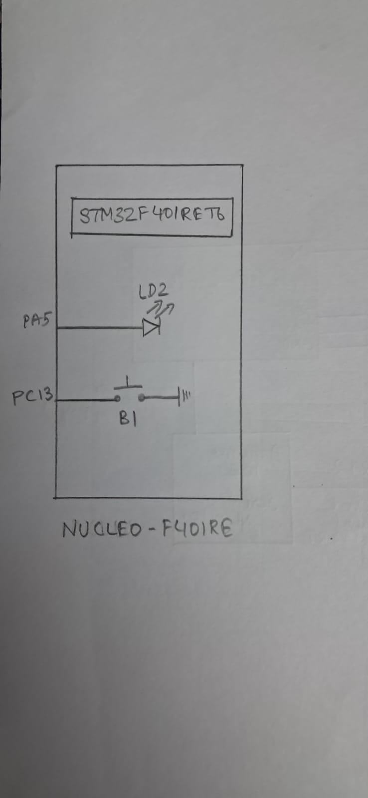

# EXP
CAT12 – Task3

# DATE
14/10/2026

# NAME OF EXP
STM32F401RE Cortex-M4: GPIO and User Input Programming

# HARDWARE SETUP / PLATFORM
- **Development Board:** NUCLEO-F401RE
- **Microcontroller:** STM32F401RET6
- **Processor Core:** ARM Cortex-M4
- **Input Peripheral:** On-board user push button (B1)
- **Button GPIO Pin:** PC13
- **Output Peripheral:** On-board LED (LD2)
- **LED GPIO Pin:** PA5
- **Development Tools:** STM32CubeMX and Keil MDK
- **Software Library:** STM32 HAL

# TASK NO
Task 3 – Short-Press and Long-Press Detection

# Circuit Diagram
The on-board user push button (B1) is connected to GPIO pin PC13, and the on-board LED (LD2) is connected to GPIO pin PA5.



No external button or LED is required. Both peripherals are available on the NUCLEO-F401RE board, which is powered through USB.

# CORE LOGIC / PSEUDOCODE / CODE BASE

## Core Logic
The program distinguishes between short and long button presses by measuring the duration for which the button remains pressed.

The HAL tick counter (`HAL_GetTick()`) is used to measure elapsed time without introducing blocking delays for press-duration measurement.

- PC13 is configured as a GPIO input.
- PA5 is configured as a push-pull output.
- When the button is detected as pressed, the program records the current tick count in `press_start`.
- When the button is released, the elapsed press duration is calculated.
- A press lasting less than 250 ms is treated as a short press.
- A press lasting 250 ms or more is treated as a long press.

### Short Press
- If blinking is inactive, the LED state is toggled.
- If blinking is active, the LED is turned OFF and blinking is stopped.

### Long Press
- If blinking is inactive, the LED is turned ON and blinking mode is enabled.
- The LED then toggles at 100 ms intervals.
- If blinking is already active, another long press does not change the current mode.

## Pseudocode

```text
START

Initialize HAL
Configure system clock
Initialize GPIO

pressed = 0
press_start = 0
isBlinking = 0
blink_start = 0

WHILE TRUE

    Read the state of PC13

    IF PC13 is LOW THEN

        IF pressed == 0 THEN
            pressed = 1
            press_start = current HAL tick
        END IF

    ELSE

        IF pressed == 1 THEN

            pressed = 0
            duration = current HAL tick - press_start

            IF duration < 250 milliseconds THEN

                IF isBlinking == 0 THEN
                    Toggle LED on PA5
                ELSE
                    Turn OFF LED on PA5
                    isBlinking = 0
                END IF

            ELSE

                IF isBlinking == 0 THEN
                    Turn ON LED on PA5
                    isBlinking = 1
                    blink_start = current HAL tick
                END IF

            END IF

        END IF

    END IF

    IF isBlinking == 1 THEN

        IF current HAL tick - blink_start >= 100 milliseconds THEN
            Toggle LED on PA5
            blink_start = current HAL tick
        END IF

    END IF

END WHILE

END
```

## Code Base
- `main.c` – Contains the short-press and long-press detection logic, LED blinking control, system clock configuration and GPIO initialization.
- `main.h` – Contains the project header declarations and HAL-related definitions.
- STM32CubeMX-generated project files – Contain the configuration and supporting files required to build the application.

# INFERENCE
The program used the HAL tick counter to distinguish between short and long button presses without using blocking delays to measure the press duration.

A short press toggled the LED when blinking was inactive, while a short press during blinking stopped the blinking and turned the LED OFF. A long press started continuous LED blinking, with the LED state changing at 100 ms intervals.

The implementation demonstrates time-based user input detection and GPIO control. The supplied code does not implement button debouncing, and a long press while blinking is already active does not change the current mode.