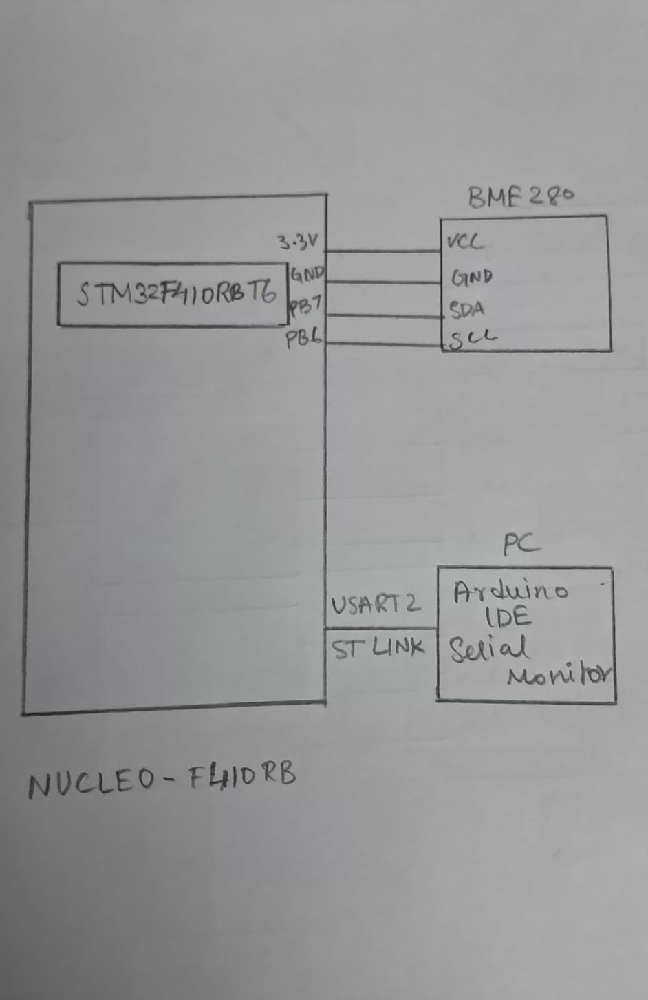

# CAT13 – BME280 Sensor Interfacing Using I²C and Bosch Sensor API

## EXP
CAT13

## DATE
23/10/2026

## NAME OF EXP
BME280 Sensor Interfacing Using I²C and Bosch Sensor API

## HARDWARE SETUP / PLATFORM

- **Development Board:** NUCLEO-F410RB
- **Microcontroller:** STM32F410RBT6
- **Processor Core:** ARM Cortex-M4
- **Sensor:** Bosch BME280 Environmental Sensor
- **Communication Protocol:** I²C (I²C1)
- **Serial Communication:** USART2
- **Debugging / Serial Interface:** ST-Link Virtual COM Port
- **Software Tools:** STM32CubeMX, Keil MDK, Arduino IDE Serial Monitor
- **Libraries:** STM32 HAL Library and Bosch Sensortec BME280 Sensor API

## TASK NO
Task 1 – BME280 Sensor Interfacing Using I²C and Bosch Sensor API

## CIRCUIT DIAGRAM

The BME280 sensor is interfaced with the STM32F410RBT6 using the I²C1 peripheral.

The connections include:

- BME280 VCC → 3.3V supply
- BME280 GND → GND
- BME280 SDA → STM32 I²C1 SDA pin
- BME280 SCL → STM32 I²C1 SCL pin

The sensor's I²C address is configured as `0x76` using `BME280_I2C_ADDR_PRIM`.

USART2 is used to transmit the measured sensor values to the PC through the board's ST-Link Virtual COM Port.

**Note:** The exact STM32 I²C1 pin numbers should match the CubeMX configuration used in the project.

## CORE LOGIC / PSEUDOCODE / CODE BASE

### Core Logic

The application interfaces the BME280 environmental sensor with the STM32 microcontroller using the I²C communication protocol. The Bosch Sensortec BME280 Sensor API is used to initialise the sensor, configure its measurement settings, read sensor data, and apply the built-in compensation algorithms.

Custom I²C read and write functions are implemented using STM32 HAL APIs to connect the Bosch driver with the STM32 I²C peripheral.

The compensated temperature, pressure, and humidity values are periodically transmitted to the PC through USART2 and displayed using the Arduino IDE Serial Monitor.

### Pseudocode

**1. Initialisation**

1. Initialise the STM32 HAL library.
2. Configure the system clock.
3. Initialise GPIO, I²C1, and USART2 peripherals.
4. Set the BME280 I²C address to `0x76`.
5. Configure the Bosch API interface structure:
   - Assign the I²C interface pointer.
   - Assign the custom I²C read function.
   - Assign the custom I²C write function.
   - Assign the delay function.
6. Initialise the BME280 sensor using `bme280_init()`.

**2. Sensor Configuration**

1. Configure temperature oversampling to 1×.
2. Configure pressure oversampling to 1×.
3. Configure humidity oversampling to 1×.
4. Disable the internal filter.
5. Apply the configuration using `bme280_set_sensor_settings()`.
6. Set the sensor to normal operating mode using `bme280_set_sensor_mode()`.

**3. Measurement and Data Transmission**

1. Read temperature, pressure, and humidity using `bme280_get_sensor_data()`.
2. Allow the Bosch API to apply the compensation algorithms.
3. Extract the compensated measurements:
   - Temperature in °C.
   - Pressure in hPa (converted from Pa by dividing by 100).
   - Relative humidity in %RH.
4. Format the measurements into a character buffer using `sprintf()`.
5. Transmit the formatted output through USART2 using `HAL_UART_Transmit()`.
6. Wait for one second.
7. Repeat the measurement and transmission process continuously.

### Important Functions Used

| Function | Purpose |
|---|---|
| `bme280_init()` | Initialises the BME280 sensor and reads its calibration data. |
| `bme280_set_sensor_settings()` | Configures oversampling and filter settings. |
| `bme280_set_sensor_mode()` | Sets the sensor operating mode. |
| `bme280_get_sensor_data()` | Reads compensated temperature, pressure, and humidity. |
| `user_i2c_read()` | Reads BME280 registers using STM32 HAL I²C. |
| `user_i2c_write()` | Writes to BME280 registers using STM32 HAL I²C. |
| `user_delay_us()` | Provides the delay function required by the Bosch API. |
| `HAL_UART_Transmit()` | Transmits the formatted sensor measurements to the PC. |

### Code Base

- `main.c` – Contains peripheral initialisation, Bosch API configuration, sensor measurement logic, and UART data transmission.
- `bme280.c` – Bosch BME280 Sensor API implementation.
- `bme280.h` – Bosch BME280 API function declarations and structures.
- `bme280_defs.h` – BME280 register definitions, constants, and configuration macros.

## INFERENCE

The BME280 environmental sensor was interfaced with the STM32F410RBT6 microcontroller using the I²C1 communication protocol and the Bosch Sensortec BME280 Sensor API.

The sensor was initialised and configured with 1× oversampling for temperature, pressure, and humidity measurements, with the internal filter disabled. The Bosch API performed the compensation calculations using the sensor's calibration data to obtain temperature, pressure, and relative humidity values.

The measured values were periodically transmitted through USART2 using the ST-Link Virtual COM Port and displayed on the Arduino IDE Serial Monitor.

This experiment demonstrated sensor interfacing using I²C, integration of an external sensor driver with STM32 HAL, compensated environmental data acquisition, and UART-based serial monitoring.