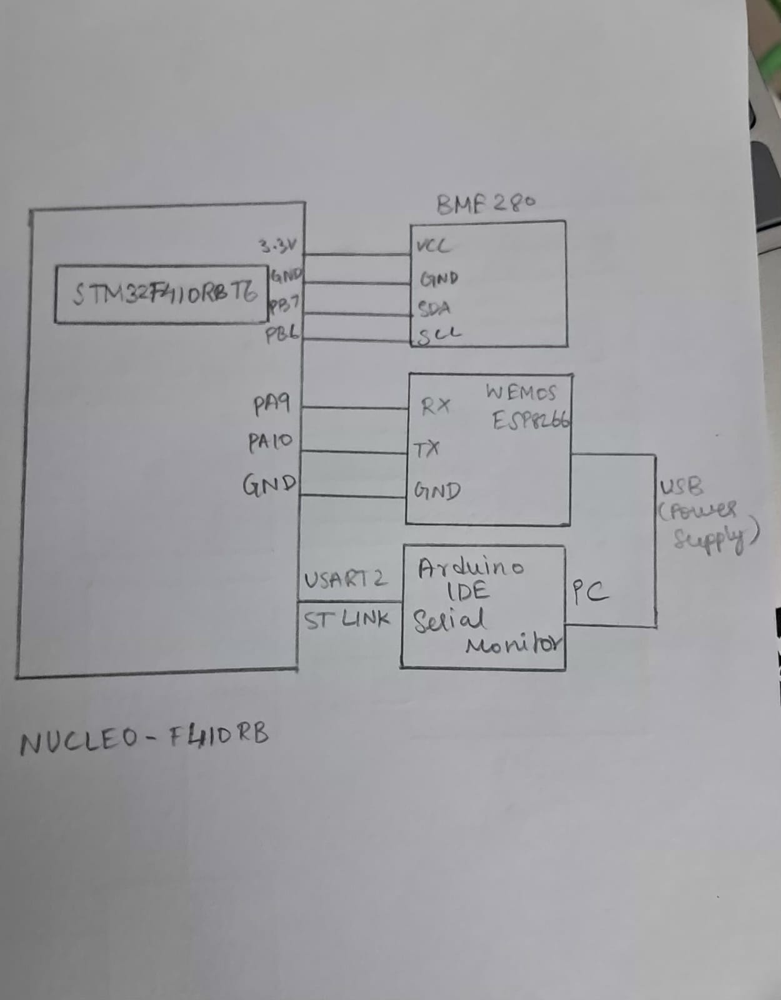

# EXP: CAT14

## DATE
27/10/2026

## NAME OF EXP
BME280 Sensor Interfacing Using I²C and (MQTT) using Custom Built ESP8266 API

## HARDWARE SETUP / PLATFORM

- **Development Board:** STM32 NUCLEO-F410RB
- **Microcontroller:** STM32F410RBT6
- **Processor Core:** ARM Cortex-M4
- **Environmental Sensor:** Bosch BME280
- **Wi-Fi Module:** ESP8266
- **Communication Protocols:**
  - I²C1 – Communication between STM32 and BME280
  - UART (USART1) – Communication between STM32 and ESP8266
  - UART (USART2) – Serial debugging and monitoring through ST-Link Virtual COM Port
  - MQTT – Publishing sensor data to the MQTT broker
- **I²C Configuration:** 100 kHz, 7-bit addressing
- **UART Configuration:** 115200 baud, 8 data bits, no parity, 1 stop bit (8N1)
- **MQTT Broker:** broker.emqx.io
- **MQTT Port:** 1883
- **MQTT Topic:** `iot/bme`
- **MQTT QoS:** 0
- **Software and Libraries:** STM32CubeMX, Keil MDK, STM32 HAL Library, Bosch BME280 Sensor API, Custom ESP8266 MQTT Library (ESPLib), Node-RED, MQTTX

## TASK NO

CAT14 – BME280 Sensor Interfacing Using I²C and MQTT with a Custom-Built ESP8266 API.

## Circuit Diagram



### Hardware Connections

The hardware setup consists of the STM32 NUCLEO-F410RB board, BME280 sensor module, and ESP8266 Wi-Fi module.

- BME280 VCC → 3.3V
- BME280 GND → GND
- BME280 SDA → STM32 I²C1 SDA
- BME280 SCL → STM32 I²C1 SCL
- ESP8266 TX → STM32 USART1 RX
- ESP8266 RX → STM32 USART1 TX
- ESP8266 GND → STM32 GND
- ESP8266 VCC → Appropriate 3.3V supply
- STM32 USART2 → ST-Link Virtual COM Port → PC

## Core Logic / Pseudocode / Code Base

### Core Logic

The application collects environmental measurements from the BME280 sensor using the I²C communication protocol. The Bosch BME280 API is used to initialize the sensor, configure its operating settings, and obtain compensated temperature, pressure, and humidity values.

The STM32 then constructs a JSON payload containing the sensor readings and publishes it to an MQTT broker through the ESP8266 Wi-Fi module using the custom ESP8266 MQTT library.

The same readings are also transmitted through USART2 for serial monitoring and debugging.

Node-RED receives the published JSON messages through an MQTT In node and processes the sensor values for visualization. MQTTX is used as an MQTT client to monitor and verify the published messages.

### Pseudocode

```text
START

1. SYSTEM INITIALIZATION
   Initialize STM32 HAL.
   Configure the system clock.
   Initialize GPIO.
   Initialize I2C1.
   Initialize USART1.
   Initialize USART2.

2. BME280 SENSOR INITIALIZATION
   Set BME280 device address to primary I2C address (0x76).

   Configure BME280 device structure:
       Set communication interface to I2C.
       Assign I2C read callback function.
       Assign I2C write callback function.
       Assign delay callback function.

   Initialize BME280 using Bosch Sensor API.

   IF initialization fails THEN
       Print initialization error through USART2.
       Enter error handler.
   ELSE
       Print initialization success message.
   END IF

3. BME280 CONFIGURATION
   Set temperature oversampling to 1x.
   Set pressure oversampling to 1x.
   Set humidity oversampling to 1x.
   Disable sensor filter.

   Apply sensor settings.

   IF configuration fails THEN
       Print configuration error.
       Enter error handler.
   END IF

   Set BME280 to NORMAL mode.

   IF mode configuration fails THEN
       Print error message.
       Enter error handler.
   END IF

4. ESP8266 INITIALIZATION
   Initialize ESP8266 in Station Mode using USART1.

   IF initialization fails THEN
       Print error message through USART2.
       Enter error handler.
   END IF

   Connect ESP8266 to Wi-Fi network.
   Configure single TCP connection mode.

5. MQTT BROKER CONNECTION
   Establish TCP connection with MQTT broker:
       Broker address = broker.emqx.io
       Port = 1883

   Initialize MQTT client parameters:
       Keep-alive = 500
       Clean session = Enabled
       Client ID = AN_Publisher

   Connect MQTT client to broker.

6. CONTINUOUS SENSOR DATA ACQUISITION AND PUBLISHING

   WHILE TRUE DO

       Read temperature, pressure and humidity
       from BME280 using Bosch Sensor API.

       IF sensor reading is successful THEN

           Store compensated temperature in Celsius.
           Convert pressure from Pa to hPa.
           Store compensated humidity in %RH.

           Construct JSON payload containing:
               Status = "success"
               Temperature
               Humidity
               Pressure

           Publish JSON payload to MQTT topic:
               Topic = "iot/bme"
               QoS = 0

           Transmit sensor readings through USART2
           for serial monitoring.

       ELSE

           Print sensor reading failure message
           through USART2.

       END IF

       Wait for 1000 milliseconds.

   END WHILE

END
```

### JSON Payload Format

The STM32 constructs a JSON message in the following format:

```json
{
  "status": "success",
  "temperature": 28.45,
  "humidity": 62.30,
  "pressure": 1008.72
}
```

The values shown are illustrative. Actual values depend on the BME280 sensor readings.

### Code Base

The implementation consists of the following source and header files:

| File | Purpose |
|---|---|
| `main.c` | Main application logic, peripheral initialization, sensor acquisition, JSON construction, and MQTT publishing |
| `bme280.c` | Bosch BME280 sensor driver implementation |
| `bme280.h` | BME280 API declarations and device structures |
| `bme280_defs.h` | BME280 constants, register definitions, and configuration macros |
| `ESPLib.c` | Custom ESP8266 and MQTT library implementation |
| `ESPLib.h` | Custom ESP8266 and MQTT library declarations |

### Important Functions Used

| Function | Purpose |
|---|---|
| `bme280_init()` | Initializes the BME280 sensor |
| `bme280_set_sensor_settings()` | Configures sensor oversampling and filter settings |
| `bme280_set_sensor_mode()` | Sets the sensor to normal mode |
| `bme280_get_sensor_data()` | Obtains compensated sensor measurements |
| `user_i2c_read()` | Implements I²C register reading using STM32 HAL |
| `user_i2c_write()` | Implements I²C register writing using STM32 HAL |
| `ESP8266_Init()` | Initializes the ESP8266 module |
| `ESP8266_wifiConnect()` | Connects the ESP8266 to the Wi-Fi network |
| `ESP8266_setSingleConnection()` | Configures single TCP connection mode |
| `ESP8266_portConnect()` | Establishes a TCP connection to the MQTT broker |
| `MQTT_connectBroker()` | Establishes the MQTT client connection |
| `MQTT_publishTopic()` | Publishes sensor data to the specified MQTT topic |
| `debug_print()` | Transmits debugging messages through USART2 |

## INFERENCE

The BME280 environmental sensor was successfully interfaced with the STM32 NUCLEO-F410RB development board using the I²C communication protocol and the Bosch BME280 Sensor API.

The STM32 acquired compensated temperature, pressure, and humidity measurements, converted the pressure readings from Pa to hPa, and formatted the sensor values into a JSON payload.

Using the custom ESP8266 MQTT library, the STM32 connected to a Wi-Fi network and an MQTT broker. The JSON-formatted sensor readings were published periodically to the MQTT topic `iot/bme` using QoS 0.

The published environmental data was received in Node-RED for monitoring and visualization. MQTTX was also used to monitor the MQTT messages, demonstrating an IoT-based environmental sensing and MQTT communication system.