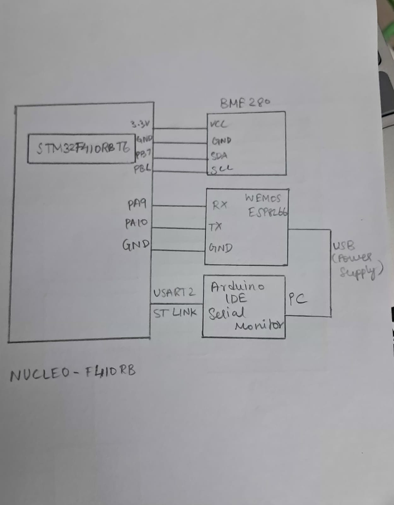
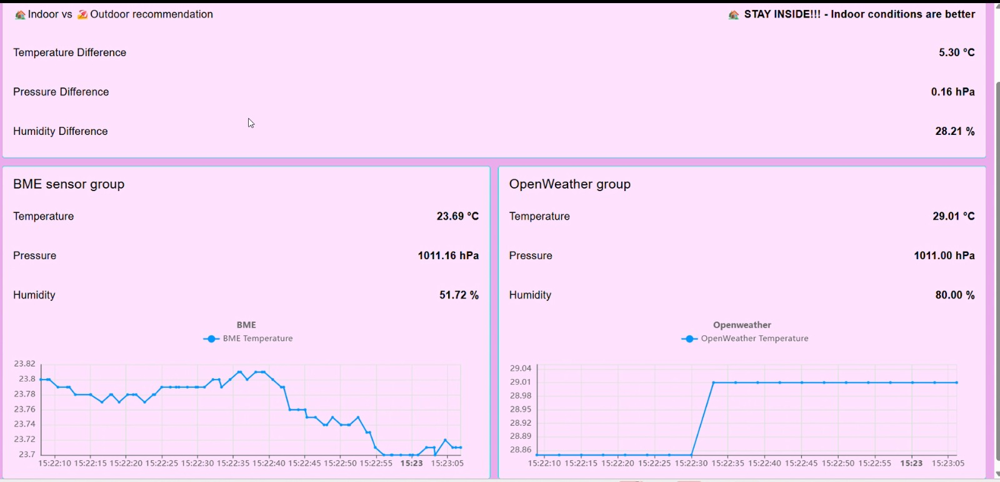

# EXP: CAT15

## DATE
02/11/2026

## NAME OF EXP
IoT-Based Indoor and Outdoor Environmental Monitoring System

## HARDWARE SETUP / PLATFORM

- **Development Board:** STM32 NUCLEO-F410RB
- **Microcontroller:** STM32F410RBT6
- **Processor Core:** ARM Cortex-M4
- **Environmental Sensor:** Bosch BME280
- **Wi-Fi Module:** ESP8266
- **Communication Protocols:**
  - I²C1 – Communication between STM32 and BME280
  - UART (USART1) – Communication between STM32 and ESP8266
  - UART (USART2) – Serial debugging and monitoring through ST-Link Virtual COM Port
  - MQTT – Publishing indoor sensor data to the MQTT broker
  - HTTP – Retrieving outdoor weather information from the OpenWeather API
- **I²C Configuration:** 100 kHz, 7-bit addressing
- **UART Configuration:** 115200 baud, 8 data bits, no parity, 1 stop bit (8N1)
- **MQTT Broker:** broker.emqx.io
- **MQTT Port:** 1883
- **MQTT Topic:** `iot/bme`
- **MQTT QoS:** 0
- **Software and Libraries:** STM32CubeMX, Keil MDK, STM32 HAL Library, Bosch BME280 Sensor API, Custom ESP8266 MQTT Library (ESPLib), Node-RED, Node-RED Dashboard 2.0, MQTTX, OpenWeather API, JavaScript

## TASK NO

CAT15 – IoT-Based Indoor and Outdoor Environmental Monitoring System.

## Circuit Diagram



### Hardware Connections

The hardware setup consists of the STM32 NUCLEO-F410RB board, BME280 sensor module, and ESP8266 Wi-Fi module. The hardware connections are the same as those used in CAT14.

- BME280 VCC → 3.3V
- BME280 GND → GND
- BME280 SDA → STM32 I²C1 SDA
- BME280 SCL → STM32 I²C1 SCL
- ESP8266 TX → STM32 USART1 RX
- ESP8266 RX → STM32 USART1 TX
- ESP8266 GND → STM32 GND
- ESP8266 VCC → Appropriate 3.3V supply
- STM32 USART2 → ST-Link Virtual COM Port → PC

## Core Logic / Pseudocode / Code Base

### Core Logic

The system monitors indoor environmental conditions using the BME280 sensor interfaced with the STM32 NUCLEO-F410RB development board through I²C.

The Bosch BME280 Sensor API is used to initialize the sensor and obtain compensated temperature, pressure, and humidity measurements. The STM32 constructs a JSON payload containing these readings and publishes it to the MQTT broker `broker.emqx.io` through the ESP8266 Wi-Fi module using the custom ESP8266 MQTT library.

Node-RED receives the published sensor data through an MQTT In node and processes the incoming JSON messages.

To obtain outdoor environmental conditions, Node-RED periodically sends an HTTP request to the OpenWeather API. The API provides outdoor temperature, humidity, and atmospheric pressure.

The indoor BME280 readings and outdoor weather data are stored and processed using Node-RED Function nodes. The system calculates the absolute differences between the corresponding indoor and outdoor parameters.

A recommendation function evaluates indoor and outdoor temperature and humidity against predefined comfort ranges. Based on these conditions, the system generates a recommendation indicating whether indoor or outdoor conditions are more comfortable.

Node-RED Dashboard 2.0 displays the indoor readings, outdoor readings, parameter differences, and the generated recommendation through an interactive dashboard.

MQTTX is used as an MQTT client to monitor and verify the sensor messages published by the STM32.

### System Workflow

**Indoor Data Acquisition:**

BME280 Sensor → STM32 → ESP8266 → MQTT Broker → Node-RED

**Outdoor Weather Data Acquisition:**

Inject Node → HTTP Request → OpenWeather API → Node-RED

**Data Processing and Visualization:**

Indoor Data + Outdoor Data → Comparison Function → Recommendation Logic → Dashboard 2.0

### Pseudocode

```text
START

1. HARDWARE INITIALIZATION
   Initialize STM32 HAL.
   Configure the system clock.
   Initialize GPIO.
   Initialize I2C1.
   Initialize USART1.
   Initialize USART2.

2. INDOOR SENSOR INITIALIZATION
   Initialize the BME280 sensor using the Bosch Sensor API.
   Configure temperature, pressure and humidity oversampling.
   Disable sensor filter.
   Set the sensor to NORMAL mode.

3. ESP8266 AND MQTT INITIALIZATION
   Initialize ESP8266 in Station Mode using USART1.
   Connect ESP8266 to the Wi-Fi network.
   Establish a TCP connection with broker.emqx.io
   using port 1883.

   Initialize MQTT client parameters.
   Connect the MQTT client to the broker.

4. INDOOR SENSOR DATA ACQUISITION
   WHILE TRUE DO

       Read temperature, pressure and humidity
       from the BME280 sensor.

       IF sensor reading is successful THEN

           Convert pressure from Pa to hPa.
           Construct JSON payload containing:
               Status
               Temperature
               Humidity
               Pressure

           Publish the JSON payload to MQTT topic:
               "iot/bme"

           Transmit readings through USART2
           for serial monitoring.

       ELSE

           Print sensor reading failure message.

       END IF

       Wait for the configured sampling interval.

   END WHILE

5. NODE-RED INDOOR DATA PROCESSING
   Receive MQTT messages through MQTT In node.
   Convert incoming JSON payload into an object.
   Extract temperature, humidity and pressure.
   Store the latest indoor sensor readings.

6. OUTDOOR WEATHER DATA ACQUISITION
   Trigger periodic weather data retrieval using
   an Inject node.

   Send an HTTP request to the OpenWeather API.

   Receive outdoor temperature, humidity and pressure.
   Extract the required weather parameters.
   Store the latest outdoor weather readings.

7. INDOOR AND OUTDOOR DATA COMPARISON
   Retrieve the latest indoor and outdoor readings.

   IF either dataset is unavailable THEN
       Stop comparison until both datasets are available.
   ELSE
       Calculate absolute temperature difference.
       Calculate absolute humidity difference.
       Calculate absolute pressure difference.
   END IF

8. COMFORT RECOMMENDATION
   Check indoor temperature and humidity
   against the predefined indoor comfort ranges.

   Check outdoor temperature and humidity
   against the predefined outdoor comfort ranges.

   IF indoor and outdoor conditions are comfortable THEN
       Recommendation = Both conditions are comfortable.

   ELSE IF only indoor conditions are comfortable THEN
       Recommendation = Stay Inside.

   ELSE IF only outdoor conditions are comfortable THEN
       Recommendation = Go Outside.

   ELSE
       Recommendation = Neither condition is ideal.
   END IF

9. DASHBOARD VISUALIZATION
   Prepare formatted values for:
       Indoor temperature, humidity and pressure.
       Outdoor temperature, humidity and pressure.
       Temperature, humidity and pressure differences.
       Indoor/outdoor comfort recommendation.

   Display the processed values on Node-RED Dashboard 2.0.

END
```

### Data Comparison and Recommendation Logic

The system calculates the absolute difference between indoor and outdoor measurements.

| Parameter | Calculation |
|---|---|
| Temperature Difference | `abs(Indoor Temperature - Outdoor Temperature)` |
| Humidity Difference | `abs(Indoor Humidity - Outdoor Humidity)` |
| Pressure Difference | `abs(Indoor Pressure - Outdoor Pressure)` |

The recommendation is generated using predefined temperature and humidity comfort ranges.

**Comfort Thresholds:**

| Parameter | Indoor Comfortable Range | Outdoor Comfortable Range |
|---|---:|---:|
| Temperature | 20–28 °C | 20–38 °C |
| Humidity | 30–60% | 30–90% |

**Recommendation Conditions:**

| Indoor Conditions | Outdoor Conditions | Recommendation |
|---|---|---|
| Comfortable | Comfortable | Both indoor and outdoor conditions are comfortable |
| Comfortable | Uncomfortable | Stay Inside |
| Uncomfortable | Comfortable | Go Outside |
| Uncomfortable | Uncomfortable | Neither condition is ideal |

The recommendation is dynamically updated according to the latest available indoor sensor readings and outdoor weather information.

The pressure difference is calculated and displayed on the dashboard but is not used in the comfort recommendation logic.

*Note: These are approximate comfort thresholds used for the project. They are not medical or environmental safety limits.*

### Node-RED Components Used

| Node | Purpose |
|---|---|
| MQTT In | Receives indoor sensor data through the `iot/bme` topic |
| JSON | Converts incoming JSON messages into JavaScript objects |
| Inject | Triggers periodic weather data retrieval |
| HTTP Request | Sends requests to the OpenWeather API |
| Function | Processes and stores BME sensor readings |
| Function | Processes and stores OpenWeather data |
| Function | Compares indoor and outdoor environmental readings |
| Function | Prepares formatted dashboard values and recommendations |
| Debug | Monitors messages and verifies processed data |
| Dashboard 2.0 – UI Text | Displays temperature, humidity, pressure, differences, and recommendation |

### Dashboard Visualization

The Node-RED Dashboard 2.0 interface is organized into three main sections.

**1. BME Sensor – Indoor Monitoring**
- Indoor temperature (°C)
- Indoor humidity (%)
- Indoor atmospheric pressure (hPa)

**2. OpenWeather – Outdoor Monitoring**
- Outdoor temperature (°C)
- Outdoor humidity (%)
- Outdoor atmospheric pressure (hPa)

**3. Environmental Comparison**
- Temperature difference
- Humidity difference
- Atmospheric pressure difference
- Automatic indoor/outdoor comfort recommendation



### Code Base

The implementation consists of the following source files and Node-RED components:

| File / Component | Purpose |
|---|---|
| `main.c` | STM32 application logic, peripheral initialization, BME280 sensor acquisition, JSON construction, and MQTT publishing |
| `bme280.c` | Bosch BME280 sensor driver implementation |
| `bme280.h` | BME280 API declarations and device structures |
| `bme280_defs.h` | BME280 constants, register definitions, and configuration macros |
| `ESPLib.c` | Custom ESP8266 and MQTT library implementation |
| `ESPLib.h` | Custom ESP8266 and MQTT library declarations |
| Node-RED Flow | Handles MQTT reception, weather API requests, data processing, and dashboard updates |
| Function Nodes | Implement data storage, comparison, formatting, and recommendation logic |

### Important Functions and Processing Logic

| Function / Component | Purpose |
|---|---|
| `bme280_init()` | Initializes the BME280 sensor |
| `bme280_get_sensor_data()` | Obtains compensated sensor measurements |
| `ESP8266_Init()` | Initializes the ESP8266 module |
| `ESP8266_wifiConnect()` | Connects the ESP8266 to the Wi-Fi network |
| `MQTT_connectBroker()` | Establishes the MQTT client connection |
| `MQTT_publishTopic()` | Publishes indoor sensor data to the MQTT topic |
| MQTT In | Receives the published BME280 readings in Node-RED |
| HTTP Request | Retrieves outdoor weather information from OpenWeather |
| Comparison Function | Calculates the differences between indoor and outdoor readings |
| Recommendation Function | Determines the indoor/outdoor comfort recommendation |
| Dashboard Preparation Function | Formats the readings, differences, and recommendation for display |

## INFERENCE

Successfully developed an IoT-based indoor and outdoor environmental monitoring system using the STM32 NUCLEO-F410RB development board, BME280 sensor, ESP8266 Wi-Fi module, MQTT, and Node-RED.

The BME280 sensor was used to acquire indoor temperature, humidity, and pressure measurements. The STM32 transmitted the sensor readings to the MQTT broker through the ESP8266 module using the custom-built MQTT library.

Node-RED received the indoor sensor data and retrieved outdoor weather information from the OpenWeather API through HTTP requests. The system processed both datasets and calculated the differences in temperature, humidity, and atmospheric pressure.

A comfort-based recommendation mechanism was implemented using predefined temperature and humidity ranges to determine whether indoor or outdoor environmental conditions were more comfortable.

The final results were displayed through an interactive Node-RED Dashboard 2.0 interface, providing centralized visualization of indoor readings, outdoor readings, parameter differences, and automatic recommendations.

The project demonstrates the integration of embedded sensor interfacing, MQTT communication, external API integration, real-time data processing, and dashboard-based visualization in an IoT application.