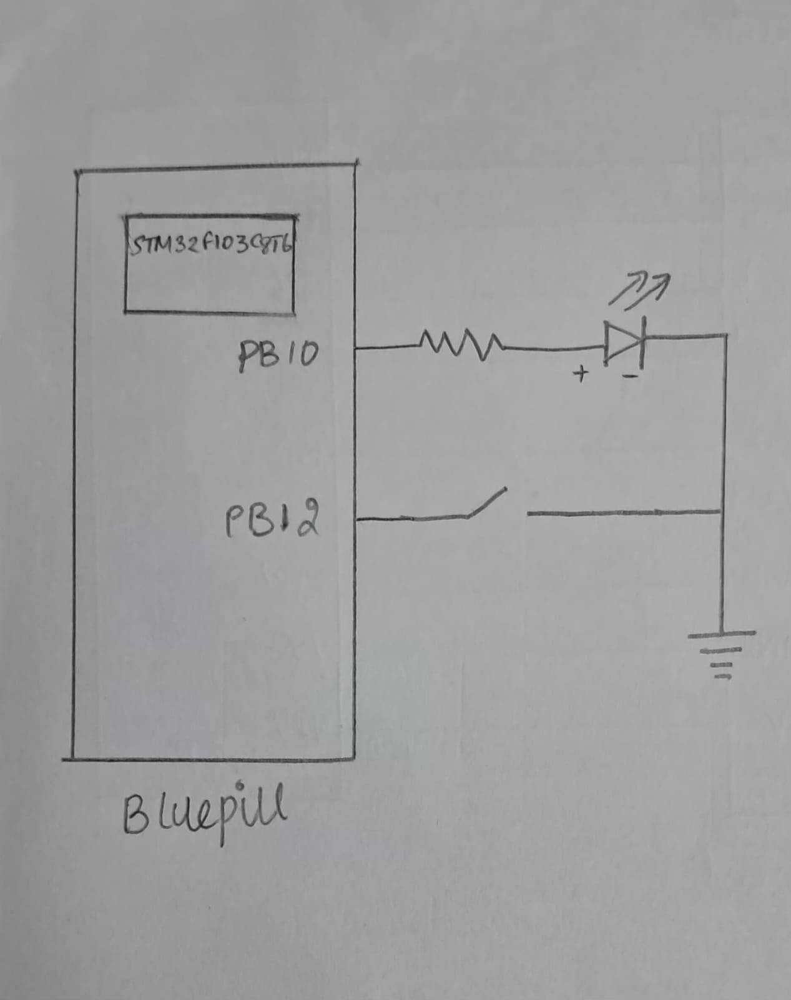

# CAT 8 – STM32 GPIO Bring-Up and Switch-Controlled LED

## EXP
CAT1 – STM32 GPIO Bring-Up and Switch-Controlled LED

## DATE
18/09/2026 

## NAME OF EXP
STM32 GPIO Bring-Up and Switch-Controlled LED

## HARDWARE SETUP / PLATFORM
- **Development Board:** STM32 Blue Pill
- **Microcontroller:** STM32
- **LED Output Pin:** PB10
- **Push-Button Input Pin:** PB12
- **Software Platform:** STM32CubeMX and Keil MDK
- **Firmware Library:** STM32 HAL

### GPIO Configuration

| Pin | Function | Configuration |
|---|---|---|
| PB10 | LED control | GPIO output, push-pull |
| PB12 | Push-button input | GPIO input, internal pull-up |

The push-button is active LOW. PB12 reads `GPIO_PIN_RESET` when pressed and `GPIO_PIN_SET` when released.

### Clock Configuration

The system clock is configured using the external high-speed oscillator (HSE) as the PLL source, with a PLL multiplication factor of 9.

The AHB clock divider is set to 1, APB1 divider to 2 and APB2 divider to 1. With an 8 MHz HSE source, this configuration produces a 72 MHz system clock.

## TASK NO

This experiment consists of three tasks from Continuous Lab Evaluation-8:

1. **Task 1 – GPIO Input/Output:** Configure the push-button and LED so that the LED follows the switch state.
2. **Task 2 – Event-Based Control:** Toggle the LED once for each valid button press using software debouncing.
3. **Task 3 – Short Press vs Long Press:** Classify button presses based on duration and implement LED toggling and blinking modes.

## Circuit Diagram

The same basic hardware circuit is used for all three tasks.

The push-button is connected to PB12, configured with an internal pull-up resistor. The LED is controlled through PB10. The additional behaviour in Tasks 2 and 3 is implemented through firmware, so no additional hardware connections are required.

## Core Logic / Pseudocode / Code Base

### Task 1 – GPIO Input/Output

- Continuously read the button state using `HAL_GPIO_ReadPin()`.
- When the button is pressed, set PB10 HIGH using `HAL_GPIO_WritePin()`.
- When the button is released, set PB10 LOW.

### Task 2 – Event-Based Control

- Detect a LOW signal on PB12.
- Apply a 20 ms debounce delay.
- Confirm that the button is still pressed.
- Toggle the LED using `HAL_GPIO_TogglePin()`.
- Wait for the button to be released before accepting another press.

### Task 3 – Short Press vs Long Press

- Record the press start time using `HAL_GetTick()`.
- Apply 10 ms press and release debounce intervals.
- Calculate the duration between the recorded press and release times.
- If the duration is less than 1000 ms, toggle the LED or stop blinking if blinking is active.
- If the duration is 1000 ms or more, activate blinking mode if it is not already active.
- While blinking is active, toggle the LED every 500 ms using elapsed-time checks.

### Code Base

Each task contains its own STM32CubeMX-generated project and application source code.

- `TASK1/main.c` – GPIO input/output implementation.
- `TASK2/main.c` – Event-based LED toggling and software debouncing.
- `TASK3/main.c` – Press-duration classification, debouncing and LED blinking control.
- `main.h` and other generated project files – Supporting STM32 HAL declarations and configuration.

Refer to the individual task folders for the complete source code and implementation details.

## INFERENCE

The experiment demonstrates GPIO configuration and input/output control using the STM32 Blue Pill development board and STM32 HAL libraries. The functionality is progressively extended from direct switch-controlled LED operation to event-based toggling with software debouncing and finally to time-based classification of short and long button presses.

The experiment introduces GPIO programming, active-LOW input handling, switch debouncing and millisecond time measurement using `HAL_GetTick()`. It also demonstrates how elapsed-time checks can be used to implement LED blinking without blocking the main application loop during long-press detection.