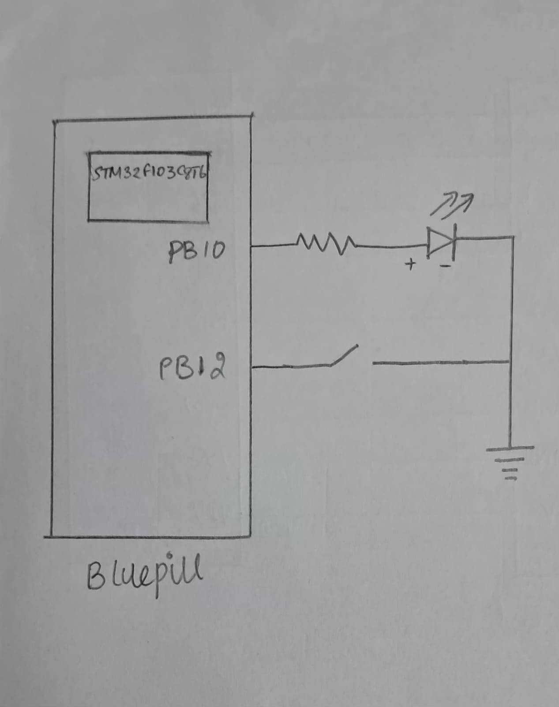

# CAT 8 – Task 1: GPIO Input/Output

## EXP
CAT 8 – Task 1

## DATE
18/09/2026 

## NAME OF EXP
STM32 GPIO Bring-Up and Switch-Controlled LED

## HARDWARE SETUP / PLATFORM
- **Development Board:** STM32 Blue Pill
- **Microcontroller:** STM32
- **LED Output Pin:** PB10
- **Push-Button Input Pin:** PB12
- **Software Platform:** STM32CubeMX and Keil MDK
- **Firmware Library:** STM32 HAL
- **Clock Configuration:** HSE oscillator with PLL multiplication factor of 9

GPIOB is enabled in the RCC configuration. PB10 is configured as a low-speed push-pull output, while PB12 is configured as an input with an internal pull-up resistor.

The push-button is active LOW:
- Button pressed: PB12 reads `GPIO_PIN_RESET`.
- Button released: PB12 reads `GPIO_PIN_SET`.

## TASK NO
**Task 1 – GPIO Input/Output**

Interface a push-button and an LED with the STM32. Configure the corresponding GPIO pins and develop firmware so that the LED follows the switch state.

## Circuit Diagram



The circuit uses PB12 as the push-button input and PB10 as the LED output. The internal pull-up configuration keeps the button input HIGH when the button is released. Pressing the button pulls PB12 LOW.

The LED is connected to PB10 through a suitable current-limiting resistor. The exact LED polarity and wiring should match the physical circuit used during the experiment.

## Core Logic / Pseudocode / Code Base

### Core Logic

1. Initialize the HAL library.
2. Configure the system clock.
3. Initialize GPIO pins.
4. Continuously read the push-button state from PB12.
5. If the button is pressed (LOW), set PB10 HIGH.
6. Otherwise, set PB10 LOW.
7. Repeat continuously.

### Pseudocode

```text
START

Initialize HAL
Configure system clock
Initialize GPIO

REPEAT FOREVER:
    Read push-button state from PB12

    IF button is pressed:
        Set LED output PB10 HIGH
    ELSE:
        Set LED output PB10 LOW

END
```

### Important Code Segment

```c
while (1)
{
    if (HAL_GPIO_ReadPin(GPIOB, GPIO_PIN_12) == GPIO_PIN_RESET)
    {
        HAL_GPIO_WritePin(GPIOB, GPIO_PIN_10, GPIO_PIN_SET);
    }
    else
    {
        HAL_GPIO_WritePin(GPIOB, GPIO_PIN_10, GPIO_PIN_RESET);
    }
}
```

### Code Base
- `main.c` – Application logic, system clock configuration and GPIO initialization.
- `main.h` – Main application header.
- Other STM32CubeMX-generated project files required for building the firmware.

## INFERENCE

The experiment demonstrates basic GPIO input and output operation using the STM32 HAL library. The push-button state is continuously monitored through PB12, and the LED output at PB10 is controlled accordingly. The experiment establishes the foundation for event-based input handling and more advanced GPIO applications.