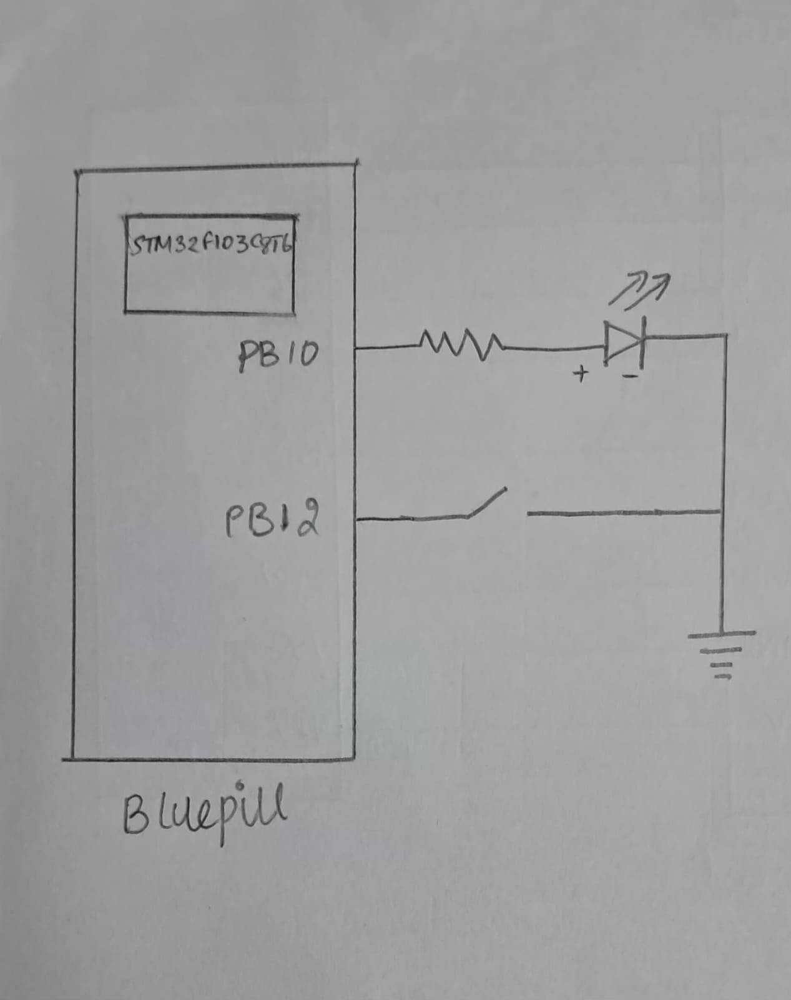

# CAT 8 – Task 2: Event-Based Control

## EXP
CAT 8 – Task 2

## DATE
18/09/2026

## NAME OF EXP
STM32 GPIO Bring-Up and Switch-Controlled LED

## HARDWARE SETUP / PLATFORM
- **Development Board:** STM32 Blue Pill
- **Microcontroller:** STM32
- **LED Output Pin:** PB10
- **Push-Button Input Pin:** PB12
- **Software Platform:** STM32CubeMX and Keil MDK
- **Firmware Library:** STM32 HAL

PB10 is configured as a push-pull output, and PB12 is configured as an input with an internal pull-up resistor.

The button is active LOW:
- Pressed: `GPIO_PIN_RESET`
- Released: `GPIO_PIN_SET`

The same hardware connections used in Task 1 are retained.

## TASK NO
**Task 2 – Event-Based Control**

Modify the firmware so that each valid switch press toggles the LED state. Investigate switch bounce and implement a simple software solution to ensure one press produces one toggle.

## Circuit Diagram



The same push-button and LED connections used in Task 1 are used here:
- Push-button input: PB12
- LED output: PB10

No additional hardware is required for the software debouncing implementation.

## Core Logic / Pseudocode / Code Base

### Core Logic

1. Initialize HAL, configure the system clock and initialize GPIO.
2. Continuously monitor the push-button input on PB12.
3. When PB12 reads LOW, wait for 20 ms to allow initial switch bounce to settle.
4. Read PB12 again.
5. If it is still LOW, consider the press valid and toggle the LED using `HAL_GPIO_TogglePin()`.
6. Wait until the button is released before accepting another press.
7. Repeat continuously.

### Pseudocode

```text
START

Initialize HAL
Configure system clock
Initialize GPIO

REPEAT FOREVER:
    IF button PB12 is LOW:
        Wait for 20 ms

        IF button PB12 is still LOW:
            Toggle LED at PB10

            WHILE button PB12 remains LOW:
                Wait for button release

END
```

### Important Code Segment

```c
while (1)
{
    if (HAL_GPIO_ReadPin(GPIOB, GPIO_PIN_12) == GPIO_PIN_RESET)
    {
        HAL_Delay(20);

        if (HAL_GPIO_ReadPin(GPIOB, GPIO_PIN_12) == GPIO_PIN_RESET)
        {
            HAL_GPIO_TogglePin(GPIOB, GPIO_PIN_10);

            while (HAL_GPIO_ReadPin(GPIOB, GPIO_PIN_12) == GPIO_PIN_RESET);
        }
    }
}
```

### Code Base
- `main.c` – Application logic, switch debouncing, system clock configuration and GPIO initialization.
- `main.h` – Main application header.
- Other STM32CubeMX-generated project files required for building the firmware.

### Switch Debouncing

Mechanical push-buttons may produce multiple rapid HIGH/LOW transitions when pressed or released. This phenomenon is called **switch bounce**.

A 20 ms software delay is used to allow the signal to stabilize. The button is then checked again before accepting the press.

The program also waits for the button to be released before detecting another press. This ensures that holding the button does not repeatedly toggle the LED.

**Implementation note:** This approach uses `HAL_Delay()` and a blocking wait for button release. It is a simple polling-based debounce implementation.

## INFERENCE

The experiment demonstrates event-based LED control using a push-button. Unlike Task 1, where the LED directly follows the switch state, the LED changes state only when a valid button press is detected. A simple software debouncing technique is used to reduce unwanted multiple toggles caused by mechanical switch bounce.