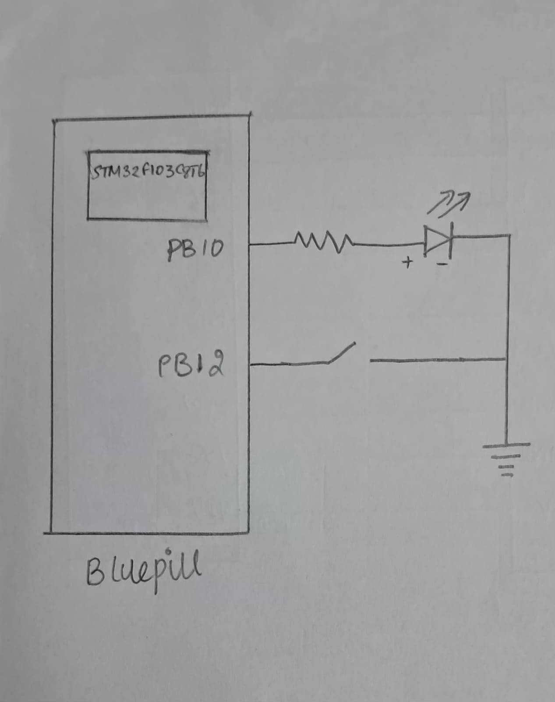

# CAT 8 – Task 3: Short Press vs Long Press

## EXP
CAT 8 – Task 3

## DATE
18/09/2026

## NAME OF EXP
STM32 GPIO Bring-Up and Switch-Controlled LED

## HARDWARE SETUP / PLATFORM
- **Development Board:** STM32 Blue Pill
- **Microcontroller:** STM32
- **LED Output Pin:** PB10
- **Push-Button Input Pin:** PB12
- **Software Platform:** STM32CubeMX and Keil MDK
- **Firmware Library:** STM32 HAL

PB10 is configured as a push-pull output, and PB12 is configured as an input with an internal pull-up resistor.

The push-button is active LOW:
- Pressed: `GPIO_PIN_RESET`
- Released: `GPIO_PIN_SET`

The same hardware connections used in Tasks 1 and 2 are retained.

## TASK NO
**Task 3 – Short Press vs Long Press**

Modify the application to classify a button press according to how long the button remains pressed.

The required behaviour is:

| User action | System response |
|---|---|
| Short press (less than 1 second) | Toggle LED |
| Long press (1 second or more) | Enter continuous blinking mode |
| Next short press | Stop blinking |
| Long press again | Return to blinking mode |

The application must not use a blocking delay to determine whether a button press is short or long.

## Circuit Diagram



The same hardware connections used in Tasks 1 and 2 are retained:
- Push-button input: PB12
- LED output: PB10

The short-press and long-press behaviour is implemented entirely in software.

## Core Logic / Pseudocode / Code Base

### Core Logic

1. Initialize HAL, configure the system clock and initialize GPIO.
2. Continuously monitor the push-button input using `HAL_GPIO_ReadPin()`.
3. When a possible button press is detected, record the starting time using `HAL_GetTick()`.
4. Confirm the press using a 10 ms software debounce interval.
5. When the button is released, record the release time.
6. Confirm the release using another 10 ms debounce interval.
7. Calculate the press duration:

   `Press duration = Release time - Press start time`

8. Classify the press:
   - If the duration is less than 1000 ms:
     - If blinking is inactive, toggle the LED.
     - If blinking is active, stop blinking and turn the LED OFF.
   - If the duration is 1000 ms or more:
     - If blinking is inactive, enable blinking mode and begin blinking.
     - If blinking is already active, leave it active.
9. While blinking mode is active, toggle the LED every 500 ms using `HAL_GetTick()`.
10. Continue monitoring the button without using a blocking delay for long-press detection.

### Pseudocode

```text
START

Initialize HAL
Configure system clock
Initialize GPIO

Initialize:
    pressed = 0
    isBlinking = 0

REPEAT FOREVER:

    IF button is pressed:
        Record press start time
        Apply 10 ms press debounce
        Confirm button press

    ELSE IF button is released after a valid press:
        Record release time
        Apply 10 ms release debounce
        Confirm button release

        Calculate press duration

        IF duration < 1000 ms:
            IF blinking is inactive:
                Toggle LED
            ELSE:
                Turn LED OFF
                Stop blinking

        ELSE:
            IF blinking is inactive:
                Start blinking mode
                Record blinking start time

    IF blinking is active:
        IF 500 ms has elapsed:
            Toggle LED
            Update blinking start time

END
```

### Important Code Segments

**1. Recording the press start time**

```c
debounce = HAL_GetTick();
press_start = HAL_GetTick();
```

**2. Recording the release time**

```c
debounce = HAL_GetTick();
press_release = HAL_GetTick();
```

**3. Classifying the press duration**

```c
if (press_release - press_start < 1000)
{
    if (isBlinking == 0)
        HAL_GPIO_TogglePin(GPIOB, GPIO_PIN_10);
    else
    {
        HAL_GPIO_WritePin(GPIOB, GPIO_PIN_10, GPIO_PIN_RESET);
        isBlinking = 0;
    }
}
else if (press_release - press_start >= 1000)
{
    if (isBlinking == 0)
    {
        isBlinking = 1;
        HAL_GPIO_TogglePin(GPIOB, GPIO_PIN_10);
        blinking_start = HAL_GetTick();
    }
}
```

**4. Generating continuous blinking**

```c
if (isBlinking == 1)
{
    if ((HAL_GetTick() - blinking_start) >= 500)
    {
        blinking_start = HAL_GetTick();
        HAL_GPIO_TogglePin(GPIOB, GPIO_PIN_10);
    }
}
```

### Code Base
- `main.c` – Application logic, press-duration measurement, debounce handling, blinking control, system clock configuration and GPIO initialization.
- `main.h` – Main application header.
- Other STM32CubeMX-generated project files required for building the firmware.

### Important Implementation Details

- `HAL_GetTick()` provides a millisecond time base.
- A 10 ms interval is used to debounce both button press and release.
- Press duration is classified after the button is released.
- A duration of exactly 1000 ms is treated as a long press.
- Blinking is implemented by checking elapsed time rather than using `HAL_Delay()`.
- The LED toggles at 500 ms intervals while blinking mode is active.

The program therefore continues executing its main loop while measuring the button press and generating the blinking pattern.

## INFERENCE

The experiment demonstrates time-based event classification using the STM32 HAL library. The button press duration is measured using `HAL_GetTick()` and classified as either a short press or a long press. Short presses toggle the LED, while long presses activate continuous blinking mode. A subsequent short press stops blinking. Software debouncing is used to improve button detection, and non-blocking time checks are used for long-press detection and LED blinking.