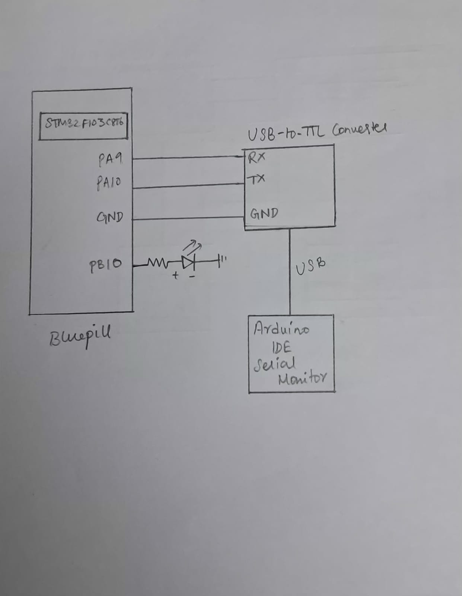

# EXP: STM32 CAT 9

## DATE
28/09/2026

## NAME OF EXP
STM32 UART Command Controlled LED

## HARDWARE SETUP / PLATFORM
- **Development Board:** STM32F103C8T6 Blue Pill
- **Microcontroller:** STM32F103C8T6
- **Processor Core:** ARM Cortex-M3
- **Peripherals:** USART1, GPIO
- **UART Configuration:**
  - Baud Rate: 9600
  - Word Length: 8 Bits
  - Stop Bits: 1
  - Parity: None
  - Mode: Transmit and Receive
  - Hardware Flow Control: None
- **UART Pins:** PA9 (TX), PA10 (RX)
- **LED Output:** PB10 (Task 3)
- **Software:** STM32CubeMX, Keil MDK, HAL Library
- **PC Terminal:** Arduino IDE Serial Monitor

## TASK NO

### Task 1 – Transmit a Character
- Configure USART1 and repeatedly transmit a character to the PC terminal.

### Task 2 – Receive and Echo
- Receive a character from the PC terminal and transmit it back.

### Task 3 – String-Based Application Logic
- Develop a UART command interface to control the LED using the commands `LED ON`, `LED OFF` and `LED TOGGLE`.

## Circuit Diagram

The STM32F103C8T6 Blue Pill communicates with the PC through USART1 using a USB-to-TTL serial converter.

**UART connections:**
- PA9 (USART1_TX) → RX of USB-to-TTL converter
- PA10 (USART1_RX) → TX of USB-to-TTL converter
- GND → GND

For Task 3, an LED is connected to PB10 through a current-limiting resistor, with its cathode connected to GND.

## Core Logic / Pseudocode / Code Base

The experiment is divided into three tasks:

**Task 1 – Character Transmission**
1. Initialize USART1 using the HAL library.
2. Configure UART communication at 9600 baud with 8 data bits, no parity and 1 stop bit.
3. Repeatedly transmit the character `'A'` to the PC terminal using `HAL_UART_Transmit()`.

**Task 2 – Character Reception and Echo**
1. Initialize USART1.
2. Receive one character from the PC terminal using `HAL_UART_Receive()`.
3. Transmit carriage return (`'\r'`) and line feed (`'\n'`).
4. Transmit the received character back to the terminal.

**Task 3 – UART Command-Controlled LED**
1. Receive command characters from the PC terminal.
2. Store the characters in a buffer until a carriage return or line feed is received.
3. Compare the completed command with predefined strings using `strcmp()`.
4. Control the LED connected to PB10 based on the received command.
5. Use `HAL_GetTick()` to implement continuous LED blinking at 500 ms intervals without using a blocking delay.
6. Transmit the corresponding response message to the PC terminal.

**HAL APIs Used:**
- `HAL_UART_Init()`
- `HAL_UART_Transmit()`
- `HAL_UART_Receive()`
- `HAL_GPIO_WritePin()`
- `HAL_GPIO_TogglePin()`
- `HAL_GetTick()`

## INFERENCE

UART communication was successfully implemented using the USART1 peripheral of the STM32F103C8T6 Blue Pill board.

The experiment demonstrates character transmission, character reception, echo communication and string-based command processing through a PC terminal. The received commands are used to control an LED through GPIO, while `HAL_GetTick()` provides non-blocking timing for continuous LED blinking.

The experiment provides practical understanding of UART serial communication, HAL peripheral APIs, command processing and GPIO control.