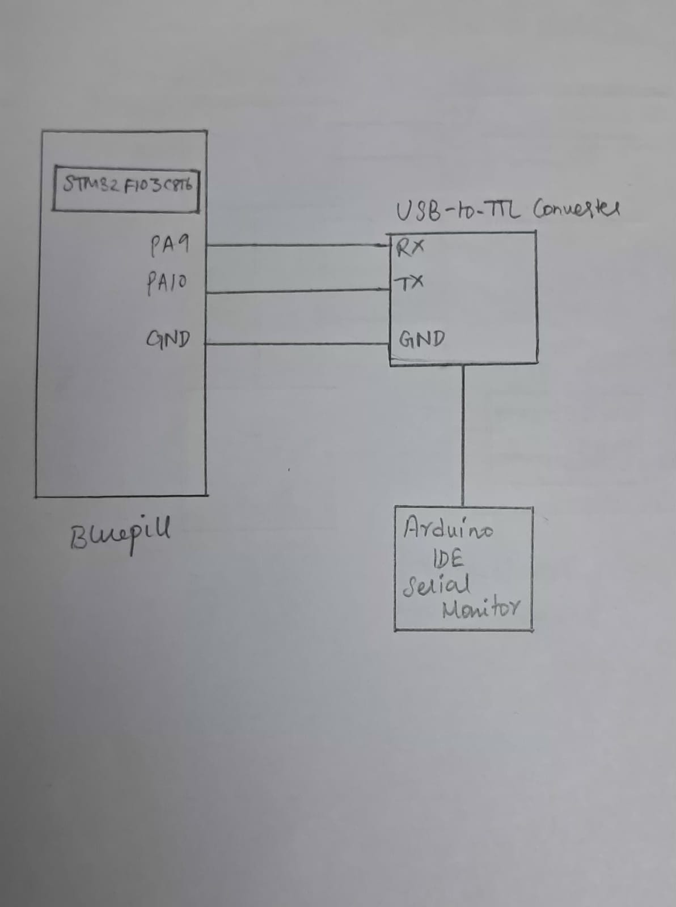

# EXP: STM32 CAT 9 – Task 1

## DATE
28/09/2026

## NAME OF EXP
STM32 UART Command Controlled LED

## HARDWARE SETUP / PLATFORM
- **Development Board:** STM32F103C8T6 Blue Pill
- **Microcontroller:** STM32F103C8T6
- **Processor Core:** ARM Cortex-M3
- **Peripheral:** USART1
- **UART Configuration:**
  - Baud Rate: 9600
  - Word Length: 8 Bits
  - Stop Bits: 1
  - Parity: None
  - Mode: Transmit and Receive
  - Hardware Flow Control: None
- **Software:** STM32CubeMX, Keil MDK, HAL Library
- **PC Terminal:** Arduino IDE Serial Monitor

## TASK NO
**Task 1 – Transmit a Character**

Configure UART communication between the STM32 board and a PC terminal and repeatedly transmit a character to the terminal.

## Circuit Diagram


The STM32 USART1 interface is used for serial communication with the PC through a USB-to-TTL serial converter.

Typical USART1 connections:
- PA9 (USART1_TX) → RX of USB-to-TTL converter
- PA10 (USART1_RX) → TX of USB-to-TTL converter
- GND → GND

The UART pin configuration is handled through the CubeMX-generated HAL initialization.

## Core Logic / Pseudocode / Code Base

### Core Logic

1. Initialize the HAL library using `HAL_Init()`.
2. Configure the system clock.
3. Initialize GPIO and USART1.
4. Configure USART1 with a baud rate of 9600, 8 data bits, no parity and 1 stop bit.
5. Store the character `'A'` in a variable.
6. Continuously transmit the character using `HAL_UART_Transmit()`.

### Pseudocode

```text
START

Initialize HAL Library
Configure System Clock
Initialize GPIO
Initialize USART1 with:
    Baud Rate = 9600
    Word Length = 8 bits
    Stop Bits = 1
    Parity = None
    Mode = Transmit and Receive

Store character 'A' in a variable

REPEAT FOREVER:
    Transmit the character 'A' through USART1
END REPEAT

STOP
```

**Core Code:**
```c
uint8_t data = 'A';

while (1)
{
    HAL_UART_Transmit(&huart1, &data, 1, HAL_MAX_DELAY);
}
```

**HAL API Used:**
- `HAL_UART_Init()` – Initializes the UART peripheral.
- `HAL_UART_Transmit()` – Transmits data through UART.

## INFERENCE

UART communication was configured between the STM32F103C8T6 board and the PC terminal using USART1. The character `'A'` was repeatedly transmitted and could be observed on the terminal.

The experiment demonstrates basic serial data transmission using the STM32 HAL library.