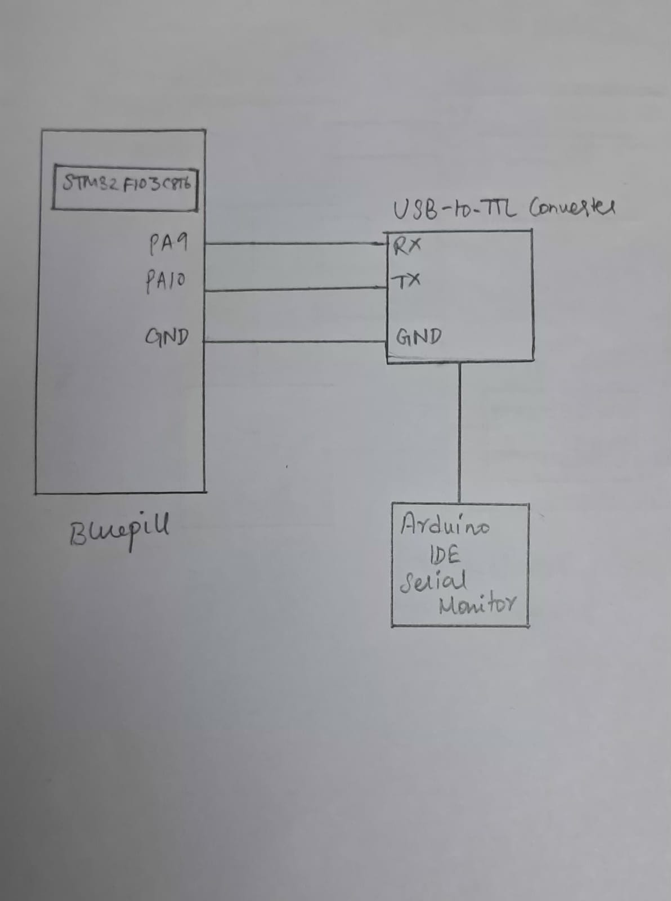

# EXP: STM32 CAT 9 – Task 2

## DATE
28/09/2026

## NAME OF EXP
STM32 UART Command Controlled LED

## HARDWARE SETUP / PLATFORM
- **Development Board:** STM32F103C8T6 Blue Pill
- **Microcontroller:** STM32F103C8T6
- **Processor Core:** ARM Cortex-M3
- **Peripheral:** USART1
- **UART Configuration:**
  - Baud Rate: 9600
  - Word Length: 8 Bits
  - Stop Bits: 1
  - Parity: None
  - Mode: Transmit and Receive
  - Hardware Flow Control: None
- **Software:** STM32CubeMX, Keil MDK, HAL Library
- **PC Terminal:** Arduino IDE Serial Monitor

## TASK NO
**Task 2 – Receive and Echo**

Modify the UART program to receive a character from the PC terminal and transmit the received character back to the terminal.

## Circuit Diagram


The STM32 USART1 interface communicates with the PC through a USB-to-TTL serial converter.

Typical USART1 connections:
- PA9 (USART1_TX) → RX of USB-to-TTL converter
- PA10 (USART1_RX) → TX of USB-to-TTL converter
- GND → GND

## Core Logic / Pseudocode / Code Base

### Core Logic

1. Initialize the HAL library, system clock, GPIO and USART1.
2. Configure USART1 for 9600 baud, 8 data bits, no parity and 1 stop bit.
3. Declare a variable to store the received character.
4. Continuously wait for one character using `HAL_UART_Receive()`.
5. After receiving a character, transmit the carriage return character (`'\r'`).
6. Transmit the line feed character (`'\n'`).
7. Transmit the received character using `HAL_UART_Transmit()`.

### Pseudocode

```text
START

Initialize HAL Library
Configure System Clock
Initialize GPIO
Initialize USART1 with:
    Baud Rate = 9600
    Word Length = 8 bits
    Stop Bits = 1
    Parity = None
    Mode = Transmit and Receive

Declare a variable to store the received character
Declare carriage return (CR) = '\r'
Declare line feed (LF) = '\n'

REPEAT FOREVER:
    Wait until one character is received through USART1

    Transmit carriage return (CR)
    Transmit line feed (LF)

    Transmit the received character back to the PC terminal
END REPEAT

STOP
```

**Core Code:**
```c
uint8_t data;
uint8_t cr = '\r';
uint8_t nl = '\n';

while (1)
{
    HAL_UART_Receive(&huart1, &data, 1, HAL_MAX_DELAY);

    HAL_UART_Transmit(&huart1, &cr, 1, HAL_MAX_DELAY);
    HAL_UART_Transmit(&huart1, &nl, 1, HAL_MAX_DELAY);
    HAL_UART_Transmit(&huart1, &data, 1, HAL_MAX_DELAY);
}
```

**HAL APIs Used:**
- `HAL_UART_Init()` – Initializes the UART peripheral.
- `HAL_UART_Receive()` – Receives data through UART.
- `HAL_UART_Transmit()` – Transmits data through UART.

## INFERENCE

UART reception and transmission were implemented using the STM32 HAL library. Each character entered through the PC terminal was received by the STM32 and transmitted back after sending carriage return and line feed characters.

The experiment demonstrates basic UART two-way communication and character echoing.