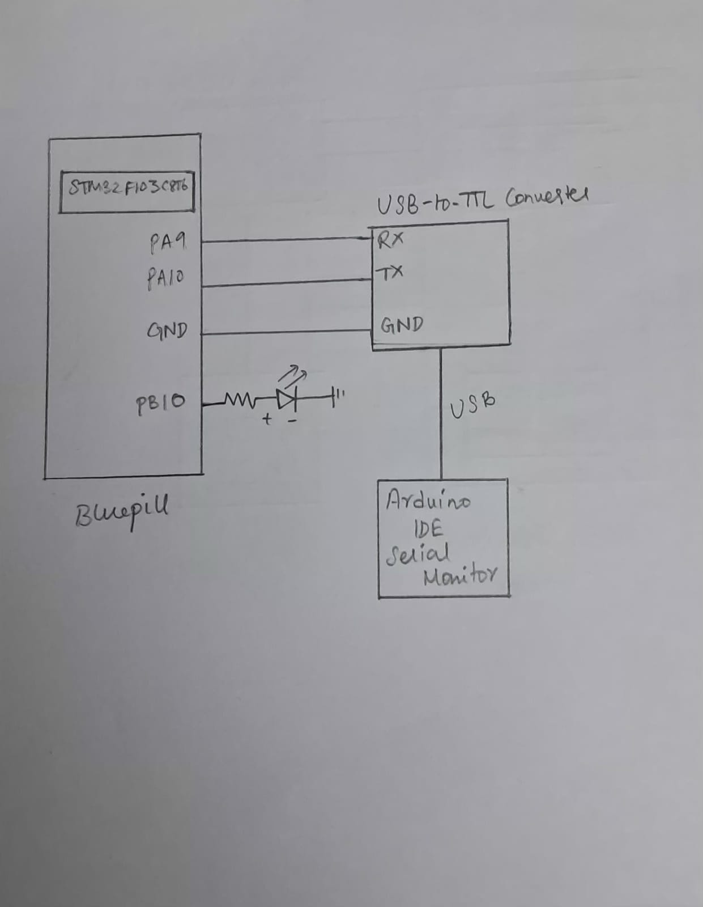

# EXP: STM32 CAT 9 – Task 3

## DATE
28/09/2026

## NAME OF EXP
STM32 UART Command Controlled LED

## HARDWARE SETUP / PLATFORM
- **Development Board:** STM32F103C8T6 Blue Pill
- **Microcontroller:** STM32F103C8T6
- **Processor Core:** ARM Cortex-M3
- **Peripherals:** USART1, GPIO
- **UART Configuration:**
  - Baud Rate: 9600
  - Word Length: 8 Bits
  - Stop Bits: 1
  - Parity: None
  - Mode: Transmit and Receive
  - Hardware Flow Control: None
- **LED Output:** PB10
- **Software:** STM32CubeMX, Keil MDK, HAL Library
- **PC Terminal:** Arduino IDE Serial Monitor

## TASK NO
**Task 9B – String-Based Application Logic**

Develop a UART-based command interface to control the LED through commands entered in a PC terminal.

Supported commands:
- `LED ON` – Turns the LED ON.
- `LED OFF` – Turns the LED OFF.
- `LED TOGGLE` – Starts continuous LED blinking.

The STM32 transmits a corresponding response to the PC terminal after processing each valid command.

## Circuit Diagram


The circuit consists of the STM32 Blue Pill board, a USB-to-TTL serial converter for UART communication, and an LED connected to PB10.

**UART connections:**
- PA9 (USART1_TX) → RX of USB-to-TTL converter
- PA10 (USART1_RX) → TX of USB-to-TTL converter
- GND → GND

**LED connection:**
- PB10 → Current-limiting resistor → LED anode
- LED cathode → GND

The LED connection shown assumes an active-HIGH external LED arrangement.

## Core Logic / Pseudocode / Code Base

### Core Logic

1. Initialize the HAL library, system clock, GPIO and USART1.
2. Configure USART1 for 9600 baud, 8 data bits, no parity and 1 stop bit.
3. Continuously check whether LED blinking is enabled.
4. If blinking is enabled and 500 ms have elapsed, toggle the LED using `HAL_GPIO_TogglePin()`.
5. Receive one character at a time from the PC terminal using `HAL_UART_Receive()`.
6. Store received characters in a command buffer until a carriage return (`'\r'`) or line feed (`'\n'`) is received.
7. Add the null terminator (`'\0'`) to mark the end of the command string.
8. Compare the received command using `strcmp()`:
   - If the command is `LED ON`, stop blinking and turn the LED ON.
   - If the command is `LED OFF`, stop blinking and turn the LED OFF.
   - If the command is `LED TOGGLE`, enable continuous blinking and toggle the LED immediately.
   - Otherwise, transmit an invalid-command message.
9. Transmit the corresponding response to the PC terminal using `HAL_UART_Transmit()`.

### Pseudocode

```text
START

Initialize HAL Library
Configure System Clock
Initialize GPIO
Initialize USART1

Configure PB10 as GPIO output

Declare:
    Command buffer of size 11
    Predefined commands:
        "LED ON"
        "LED OFF"
        "LED TOGGLE"

    receive_finish = 0
    count = 0
    isToggling = 0
    lastToggle = 0

REPEAT FOREVER:

    IF isToggling is enabled AND 500 ms have elapsed:
        Toggle LED connected to PB10
        Update lastToggle with current system tick
    END IF

    IF command reception is not complete:

        Attempt to receive one character through USART1
        using a 2 ms timeout

        IF a character is successfully received:

            IF received character is CR ('\r') OR LF ('\n'):
                Add null terminator to command buffer
                Set receive_finish = 1

            ELSE:
                Store received character in command buffer
                Increment count
            END IF

        END IF
    END IF

    IF receive_finish = 1:

        Reset receive_finish = 0
        Reset count = 0

        IF received command is "LED ON":

            Disable continuous blinking
            Set PB10 HIGH

            Transmit "LED turned ON"

        ELSE IF received command is "LED OFF":

            Disable continuous blinking
            Set PB10 LOW

            Transmit "LED turned OFF"

        ELSE IF received command is "LED TOGGLE":

            Enable continuous blinking
            Record current system tick
            Toggle PB10 immediately

            Transmit "LED toggled"

        ELSE:

            Transmit "Invalid Command"

        END IF

    END IF

END REPEAT

STOP
```

**Core Code:**
```c
if (strcmp(command, on) == 0)
{
    isToggling = 0;
    HAL_GPIO_WritePin(GPIOB, GPIO_PIN_10, GPIO_PIN_SET);

    char response[] = "LED turned ON\r\n";
    HAL_UART_Transmit(&huart1, (uint8_t *)response,
                      strlen(response), HAL_MAX_DELAY);
}
else if (strcmp(command, off) == 0)
{
    isToggling = 0;
    HAL_GPIO_WritePin(GPIOB, GPIO_PIN_10, GPIO_PIN_RESET);

    char response[] = "LED turned OFF\r\n";
    HAL_UART_Transmit(&huart1, (uint8_t *)response,
                      strlen(response), HAL_MAX_DELAY);
}
else if (strcmp(command, toggle) == 0)
{
    isToggling = 1;
    lastToggle = HAL_GetTick();

    char response[] = "LED toggled\r\n";
    HAL_GPIO_TogglePin(GPIOB, GPIO_PIN_10);

    HAL_UART_Transmit(&huart1, (uint8_t *)response,
                      strlen(response), HAL_MAX_DELAY);
}
```

**HAL APIs Used:**
- `HAL_UART_Init()` – Initializes the UART peripheral.
- `HAL_UART_Receive()` – Receives command characters.
- `HAL_UART_Transmit()` – Transmits responses to the terminal.
- `HAL_GPIO_WritePin()` – Sets the LED output state.
- `HAL_GPIO_TogglePin()` – Toggles the LED output state.
- `HAL_GetTick()` – Gets the elapsed system tick count for non-blocking timing.

**Additional Library Functions:**
- `strcmp()` – Compares the received command with predefined command strings.
- `strlen()` – Calculates the response string length.

## INFERENCE

A UART-based command interface was implemented using the STM32 HAL library. Commands entered through the PC terminal were received and processed by the STM32 to control the LED connected to PB10.

The `LED ON` and `LED OFF` commands control the LED state directly, while `LED TOGGLE` enables continuous blinking at 500 ms intervals. The STM32 also transmits appropriate response messages to the terminal.

The experiment demonstrates UART-based command processing, string comparison, GPIO control and non-blocking timing using `HAL_GetTick()`.